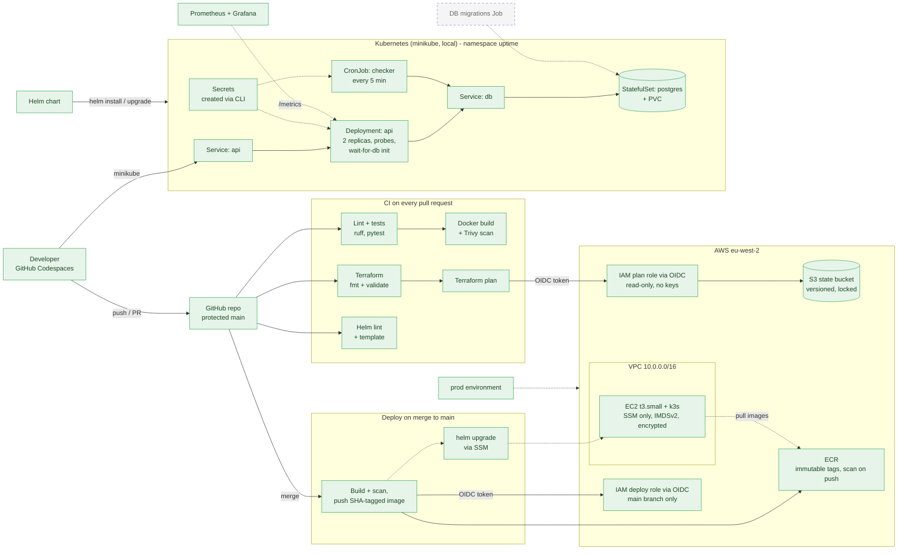

# AWS Kubernetes Platform

An end-to-end DevOps platform project: a FastAPI + PostgreSQL app, containerised with Docker, tested and scanned in GitHub Actions, packaged as a Helm chart, and deployed to Kubernetes on AWS infrastructure built with Terraform.

## Architecture

🟩 Green = built · ⬜ Grey dashed = planned

## Cost

**Total spent building the project:** about $0.45 of AWS credits (nothing charged to a card), by stopping the server between sessions and avoiding always-on managed services.
**Left running 24/7, it would cost about $22/month.** A budget alert is set up as a safety net.

| Resource | Cost if left on 24/7 (approx.) | How I keep it low |
|---|---|---|
| EC2 `t3 small` instance | ~$17 / month | Stopped at the end of every session |
| EBS disk (20 GB gp3) | ~$1.90 / month | Small disk; the main cost while stopped |
| Public IPv4 address | ~$3.60 / month | Only charged while running (no Elastic IP) |
| S3 (Terraform state + backups) | pennies | Backups expire after 7 days |
| ECR (images) | pennies | Lifecycle policy removes old images |

### What I chose not to pay for
| Avoided | Typical cost | What I used instead | Trade-off |
|---|---|---|---|
| EKS control plane | ~$73 / month | k3s on EC2 | I run the control plane myself; single point of failure |
| NAT gateway | ~$35+ / month | Public subnet + locked-down security group | The instance has a public IP, so security groups do all the protecting |
| Load balancer (ALB) | ~$18+ / month | Traefik ingress on the instance | No managed TLS or multi-instance health checks |
| Bigger instance for monitoring | ~$17+ / month more | Prometheus + Grafana on local minikube | Monitoring isn't watching the live server 24/7 |

**In a real company** I would pay for EKS, a NAT gateway and an ALB: when customers depend on the service, high availability, managed upgrades and private networking are worth the cost.

*Prices are approximate for eu-west-2 (London), checked October 2026. See the AWS pricing pages for current figures.*

## Roadmap
- [x] Dev environment defined as code (devcontainer)
- [x] Phase 1: Linux and networking basics
- [x] Phase 2: FastAPI app + Docker
- [x] Phase 3: CI with GitHub Actions
- [x] Phase 4: Terraform on AWS
- [x] Phase 5: Kubernetes locally (manifests, break/fix, Helm chart)
- [x] Phase 6: Kubernetes on AWS + automated deploys
  - [x] k3s bootstrapped on EC2 by Terraform `user_data`
  - [x] Merges to main push scanned, SHA-tagged images to ECR
  - [x] Auto-deploy to k3s with Helm via SSM
- [x] Phase 7: Monitoring and alerting
- [x] Phase 8: Security, backups, disaster recovery
- [x] Phase 9: Polish (runbook)

## Docs
- [How the app works](docs/APP.md)
- [Security decisions and vulnerability triage](docs/SECURITY.md)
- [Troubleshooting log: real issues and how they were fixed](docs/TROUBLESHOOTING.md)
- [Runbook](docs/RUNBOOK.md): deploy, rollback, alerts, backups and restore, disaster recovery (tested: full rebuild + restore in ≈17 min)
