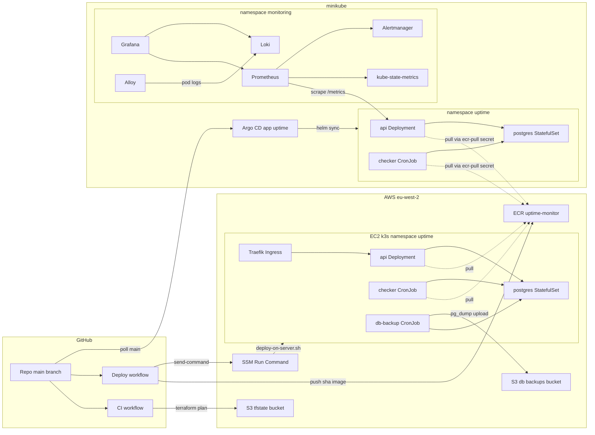
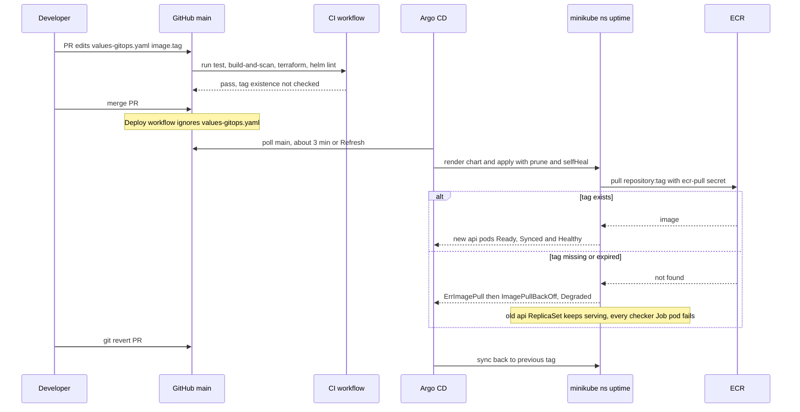
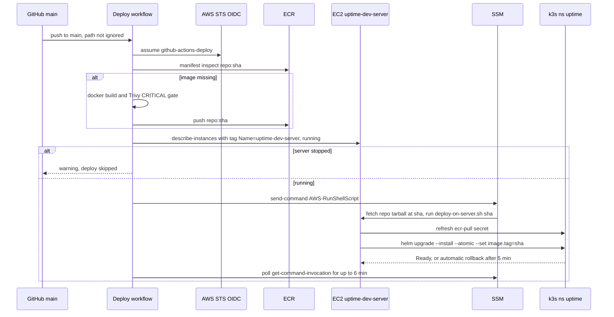
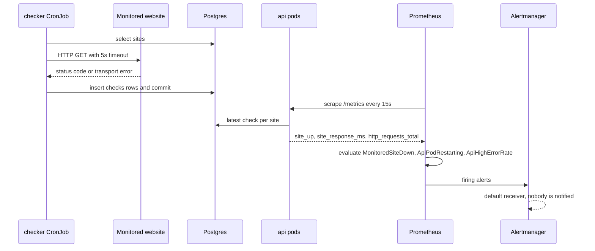
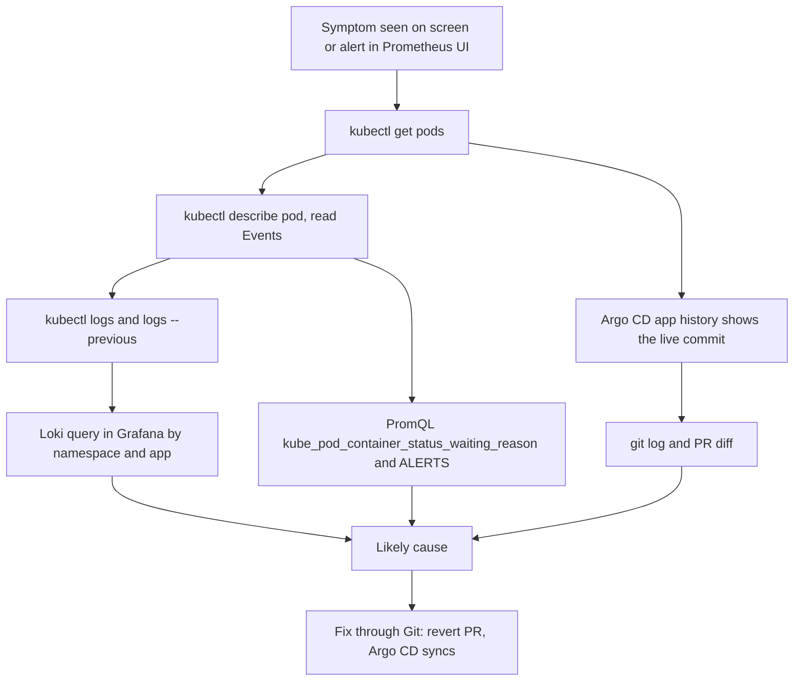

# Architecture: aws-k8s-platform

## Architecture Analysis

### System Overview

There is one Python service image, `uptime-monitor`, run by two Kubernetes workloads:

- the **Uptime API** Deployment (2 replicas);
- the **Checker CronJob**, every 5 minutes.

Both write to a single **PostgreSQL** StatefulSet. The Helm chart `helm/uptime-monitor` packages all three and can also
render an Ingress, a ServiceMonitor, a PrometheusRule and a db-backup CronJob. The chart reaches two clusters by two
different routes:

1. **AWS dev (k3s on EC2), by push.** GitHub Actions builds and pushes a SHA-tagged image to ECR. It then uses SSM to run
   `scripts/deploy-on-server.sh`, which runs `helm upgrade --install --atomic --set image.tag=<sha>`.
2. **Local minikube, by pull.** The Argo CD `Application` `uptime` tracks `main` with `values-gitops.yaml`, which pins
   the tag, and auto-syncs with prune and selfHeal.

Observability (kube-prometheus-stack, Loki, Alloy, Grafana) is installed **only on minikube**, using the values in
`monitoring/`. AWS infrastructure is Terraform: a bootstrap layer (state bucket, backups bucket, GitHub OIDC roles) and
per-environment network, compute and registry. The full component list is in `component-inventory.md`.

### Architectural Style

- **Application**: a small layered monolith.
  - API layer: `app/main.py`.
  - Logic: `app/checks.py`.
  - Persistence: `app/models.py` and `app/database.py`.
  - Cross-cutting: `app/config.py`, `app/logging_setup.py`, `app/metrics.py`.

  One image serves two process roles, a web server and a batch job, chosen by the container command.
- **Platform**: single-node Kubernetes in each environment.
  - Configuration is Twelve-Factor style: every setting comes from an environment variable (`app/config.py`).
  - Secrets are created out-of-band and never stored in Git (`values.yaml:9-11`).
  - Images are addressed by immutable SHA tags (ECR `IMMUTABLE`).
- **Delivery**: hybrid. CI pushes to AWS; GitOps pulls into minikube.

### Component Relationships

Text fallback:
- GitHub `main` triggers CI and Deploy.
  - CI only validates; its Terraform plan reads the S3 state.
  - Deploy pushes `uptime-monitor:<sha>` to ECR and uses SSM to run `deploy-on-server.sh` on EC2.
- On EC2 k3s (namespace `uptime`):
  - The Traefik Ingress routes to the api Service and Deployment.
  - api and checker connect to the `db` Service (the postgres StatefulSet).
  - The db-backup CronJob dumps postgres and uploads the dump to the S3 backups bucket.
  - Images are pulled from ECR using the `ecr-pull` secret.
- On minikube:
  - Argo CD polls `main` and syncs the chart into namespace `uptime`.
  - Prometheus scrapes the api `/metrics` endpoint (through the ServiceMonitor) and kube-state-metrics. It sends alerts to Alertmanager, which uses only the default receiver.
  - Alloy ships every pod's logs to Loki, and Grafana reads both Prometheus and Loki.

### Data Flow

1. **Write path (checks).**
   - The checker CronJob, or `POST /checks/run`, reads every `Site` and calls `httpx.get(url)`. The timeout is `CHECK_TIMEOUT_SECONDS` (default 5s).
   - It inserts one `Check` row per site, commits, and logs one JSON line per site (`app/checks.py:42-55`).
2. **Read path (status).**
   - `/status`, `/sites/{id}/checks` and `/metrics` read the latest check per site from Postgres.
   - `/metrics` clears and rebuilds the `site_up` and `site_response_ms` gauges on every scrape (`app/main.py:73-86`). CronJob results therefore show up and deleted sites disappear.
   - The gauges carry **no timestamp or age**. If the checker stops writing, `site_up` keeps reporting the last stored result.
3. **Metrics path.** ServiceMonitor `api` (port `http`, `/metrics`, every 15s) feeds Prometheus, which evaluates PrometheusRule `uptime-monitor` and sends firing alerts to Alertmanager. kube-state-metrics provides the pod status series.
4. **Log path.** The app writes JSON logs to stdout. Alloy's `loki.source.kubernetes` reads them through the Kubernetes API and sends them to Loki with the labels `namespace`, `pod`, `container` and `app`. **Kubernetes Events are not collected.**
5. **Backup path.** `pg_dump -Fc` writes to an emptyDir, then `aws s3 cp` uploads it to `s3://uptime-monitor-db-backups-099021515478/postgres/uptime-<ts>.dump`. Backups expire after 7 days. The EC2 role can Put and Get, but not Delete.

### Key Design Decisions

| Decision | Evidence | Implication |
|---|---|---|
| One image for the API and the checker | `templates/api.yaml:41`, `templates/checker.yaml:23` | A bad tag breaks both. The checker has no old pod to fall back on, so monitoring went silent in the game day |
| Immutable SHA tags in ECR | `infra/modules/registry/main.tf:16` | Each tag maps to one exact build. Redeploys reuse existing images (`deploy.yml:43-54`) |
| ECR keeps only 5 images | `infra/modules/registry/main.tf:29-43` | Older SHAs, including one pinned in the GitOps values, can expire |
| Secrets kept outside Git | `values.yaml:9-11`, `RUNBOOK.md:144-152` | A manual step after every rebuild. `DATABASE_URL` embeds the DB password |
| Liveness without the DB, readiness with it | `app/main.py:58-70`, `templates/api.yaml:48-59` | A DB outage takes pods out of service without causing restart loops |
| `wait-for-db` init container on the API only | `templates/api.yaml:35-38` | Fixes the fresh-install crash (TROUBLESHOOTING #13). The checker has no such wait |
| `helm upgrade --atomic --timeout 5m` | `scripts/deploy-on-server.sh:20-23` | On AWS, Helm rolls back automatically if new pods are not Ready within 5 minutes |
| Argo CD auto-sync with prune and selfHeal | `gitops/uptime-app.yaml:19-22` | On minikube, Git is the only lever: manual kubectl changes are reverted |
| SSM only: no SSH, IMDSv2 required, encrypted root volume | `infra/modules/compute/main.tf:68-104` | All admin access goes through IAM |
| Single-CIDR ingress on port 80 | `infra/modules/network/main.tf:43-49` | The API has no authentication, so the network rule is the only access control |
| Schema created by `create_all` at startup | `app/database.py:53-58` | No migrations, and a first-start race between replicas (TROUBLESHOOTING #12) |
| Investigation tooling lives only on minikube | `README.md:93`, `monitoring/*` | Evidence for AWS incidents is limited to kubectl and Helm history on the server |

The alternatives the project weighed (EKS, NAT gateway, ALB, monitoring on a larger instance) and why they were rejected
are recorded in `README.md:87-95`.

### Improvement Opportunities

These are observations, not proposed work. The full register is in `code-quality-assessment.md` § Technical Debt Register.

- Alerting does not cover the failure seen in the reference incident: there is no freshness signal for checks, no
  "pod stuck waiting" alert, no Alertmanager receiver, and Events are not collected (D2).
- The CI path does not validate what GitOps deploys: it never checks that the image tag exists and lints Helm only with
  default values (D3).
- There is no observability on the AWS cluster (D9).
- No least-privilege Kubernetes identities exist (D5).
- The raw `k8s/` manifests duplicate the chart and can drift from it (D12).

## Interaction Diagrams

### 1. Release via GitOps (minikube): the path of the reference incident

Text fallback:
1. A PR changes `values-gitops.yaml`.
2. CI validates the code, the image and the chart, but not whether the tag exists, and the PR is merged.
3. The Deploy workflow does not run, because the file is in its `paths-ignore` list.
4. Argo CD polls `main` and applies the rendered chart, and the kubelet pulls the image from ECR.
5. If the pull fails, new API pods go into ImagePullBackOff while the old ReplicaSet keeps serving. Every checker Job pod fails, so no new `checks` rows are written.
6. Recovery is a `git revert` PR, which Argo CD syncs back.

### 2. Release to AWS (push)

Text fallback:
1. Deploy assumes the OIDC deploy role.
2. It builds, scans and pushes the image only when `repo:sha` is not already in ECR.
3. It finds the running server by its tag. If the server is stopped, it warns and skips the deploy.
4. Otherwise it sends an SSM shell command that downloads the commit tarball and runs `deploy-on-server.sh <sha>`.
5. The script refreshes the ECR pull secret and runs `helm upgrade --atomic`.
6. The workflow polls SSM until the command succeeds or fails.

This path is only valid if GitHub accepts `deploy.yml`, which is doubtful (`code-quality-assessment.md` D1).

### 3. Uptime check and alert path

Text fallback:
1. The checker writes check rows.
2. Prometheus scrapes the API, which derives `site_up` from the **latest** row.
3. Prometheus evaluates the alert rules and sends firing alerts to Alertmanager, which has no receiver configured.

If the checker stops writing rows, `site_up` keeps its last value, so `MonitoredSiteDown` cannot fire (incident review line 35).

### 4. Incident investigation as practised today (manual)

Text fallback:
- The triage order documented in `docs/RUNBOOK.md:96` and section 8 is: get pods, describe pod (Events), logs, logs --previous, then get endpoints.
- Loki queries, PromQL (`kube_pod_container_status_waiting_reason`, `ALERTS`) and the Argo CD history fill in the rest, and Git history identifies the change.
- The fix goes through a revert PR.

All of this is done by hand across four tools (`docs/aidlc/inception/intent.md:4-5`). A pod that never started has no
logs, so Events are the only direct evidence for a failed image pull (`docs/RUNBOOK.md:232`).
