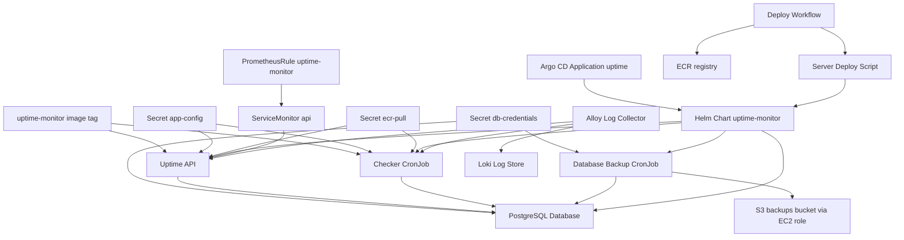

# Dependencies: aws-k8s-platform

Library and tool versions appear once, in `technology-stack.md`. This file records **who depends on what**.

## Internal Python Module Dependencies

The adjacency list is in `code-structure.md` § "Internal Dependency Graph". There are no import cycles at load time.

## Internal Component Dependencies

Text fallback:
- **Shared image tag**: one tag feeds both the Uptime API and the Checker CronJob. It is a single point of failure for the API rollout and for monitoring at the same time.
- **Secrets**, all created by hand:
  - `app-config`: API and checker.
  - `db-credentials`: postgres and the backup job.
  - `ecr-pull`: image pulls on AWS and minikube.
- **Postgres** (`db:5432`): the API, the checker and the backup job all depend on it. The API waits for it with an init container; the checker does not.
- **Helm chart consumers**: Argo CD (minikube) and `deploy-on-server.sh` (AWS). The Deploy Workflow runs the script and publishes images to ECR.
- **Alerts** depend on the ServiceMonitor scraping the API (job label `api`).
- **Logs**: Alloy reads every pod's logs through the Kubernetes API and ships them to Loki.

## Infrastructure Dependencies (Terraform)

| Consumer | Depends on | How |
|---|---|---|
| `infra/envs/dev` | `modules/network`, `modules/registry`, `modules/compute` | `module` blocks (`source = "../../modules/..."`) |
| `infra/envs/prod` | `modules/network`, `modules/compute` | `module` blocks |
| `modules/compute` (dev) | the backups bucket from `infra/bootstrap` | the **string literal** `uptime-monitor-db-backups-099021515478`, not a remote-state reference |
| every root module | the S3 state bucket from `infra/bootstrap` | `backend "s3"` |
| `.github/workflows/*` | the IAM roles from `infra/bootstrap/github_oidc.tf` | role ARNs hard-coded in the YAML |
| `github_deploy` role | the EC2 tag `Name=uptime-dev-server` from `modules/compute` | IAM condition on `ssm:resourceTag/Name` |
| prod EC2 | the ECR repository owned by **dev**'s state | coupling noted in `docs/RUNBOOK.md` section 7 "Next improvements" |

## Cross-Cutting Hard-Coded Identifiers

These values are repeated across files. Changing one means editing every listed place.

| Value | Files |
|---|---|
| AWS account `099021515478` and region `eu-west-2` | `values-aws.yaml`, `values-gitops.yaml`, `deploy-on-server.sh`, `ci.yml`, `deploy.yml`, `infra/**`, `docs/RUNBOOK.md` |
| ECR repository `…/uptime-monitor` | `values-aws.yaml:3`, `values-gitops.yaml:2`, `deploy-on-server.sh:7`, `deploy.yml:41`, `github_oidc.tf:108` |
| Namespace `uptime` | `gitops/uptime-app.yaml:18`, `deploy-on-server.sh`, `k8s/*.yaml`, the dashboard (`namespace="uptime"`), the runbook |
| Server tag `uptime-dev-server` | `deploy.yml:86`, `github_oidc.tf:138`, the runbook |
| Service name `db` | `templates/api.yaml:38` (`pg_isready -h db`), `templates/backup-cronjob.yaml:37`, the `DATABASE_URL` in the Secret |
| Service `loki.monitoring.svc:3100` | `alloy-values.yaml:39`, `kube-prometheus-stack-values.yaml:23` |
| Repository URL `github.com/AmmaarahMaroof/aws-k8s-platform` | `gitops/uptime-app.yaml:9`, `github_oidc.tf:27-28,81`, `docs/RUNBOOK.md:64` |

## External Runtime Dependencies

| Dependency | Needed by | What happens when it fails |
|---|---|---|
| Monitored websites (any URL) | the checker and `POST /checks/run` | the site is recorded as down; this is not an error |
| Private ECR and a valid 12-hour `ecr-pull` token | every pod pull on AWS and minikube | `ImagePullBackOff` (`docs/RUNBOOK.md` section 8, TROUBLESHOOTING #27) |
| ECR Public (python and trivy images) | CI builds | rate limiting; the job must be re-run (TROUBLESHOOTING #24, #26) |
| GitHub (repo tarball, Argo CD polling) | the AWS deploy script and Argo CD | the deploy or sync stalls |
| `get.k3s.io`, the Helm install script, snap | the EC2 first boot | bootstrap fails |
| Reachability of the AWS SSM agent (outbound 443) | deploys and admin access | `InvalidInstanceId` (TROUBLESHOOTING #18, #19) |
| S3 | backups and Terraform state | the backup Job fails; state lock errors |

## Dependency Risks Observed

- **Unpinned**: `amazon/aws-cli:latest`, the k3s stable channel, the Helm installer from `main`, the kube-prometheus-stack chart
  version, the Helm version in CI, ruff in CI (a range only), and GitHub Actions pinned by major tag.
- **ECR retention versus pinned tags**: the lifecycle policy keeps 5 images, whatever their status, while GitOps pins one
  specific SHA (`values-gitops.yaml:3`). Once five newer images exist, the pinned image expires and the next pod pull fails.
- **Shared image**: the API and the checker are coupled through `image.tag`, as the game day showed.
- **Secrets outside Git and outside any secret manager**: they are recreated by hand after every rebuild
  (TROUBLESHOOTING #14, `docs/RUNBOOK.md` section 7).
