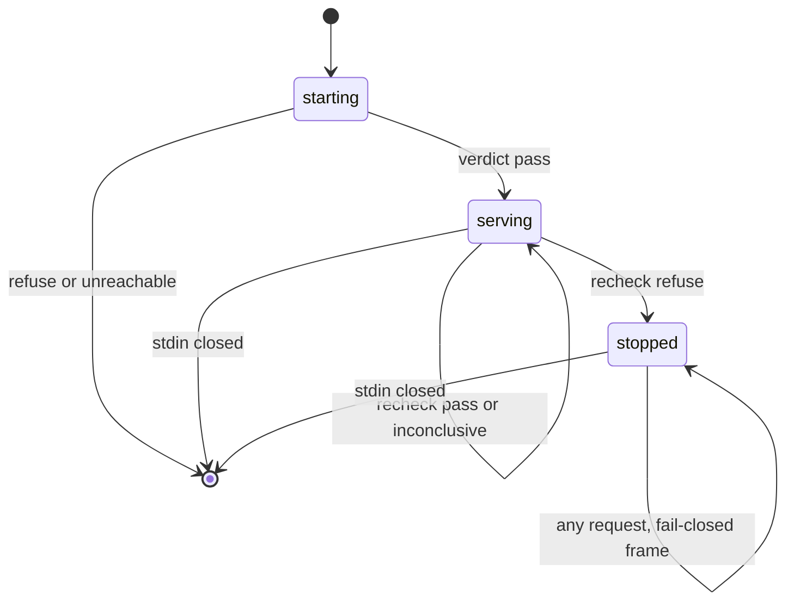
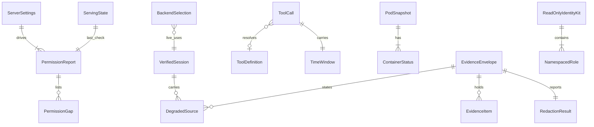

# Functional Specification: U1 Safe core (`u1-safe-core`)

This file is the source of truth for U1's workflows and state machines. The entity diagram and the rules summary below are derived views of `entities.md` and `rules.md`.

## Scope

U1 is the smallest working server. One read-only tool, `namespace_overview`, runs end to end through the start-up guard, the verified session, the minimal Kubernetes reader, the evidence pipeline and the stdio transport. U1 also delivers the prompt-registration hook (U2 supplies the prompt content), the read-only identity kit manifests, and the new CI workflow `.github/workflows/ops-assistant.yml`.

## Tool surface

| Tool | Arguments | Returns |
|---|---|---|
| `namespace_overview` | `namespace` (required, allow-listed DNS-1123 label), `since`, `until` (required, UTC ISO 8601 with `Z` or `+00:00`, `since < until`, at most 6 hours) | One envelope: header, then pod items ordered unhealthy first (BR3.3). Each pod item has name, phase, ready, unhealthy, and per container: image, ready, restart count, waiting or terminated reason and message, last termination time |

U2 widens `namespace_overview` (workloads, Warning events, Argo CD state, diagnosis line) without changing these arguments.

## Workflows

### W1 Start-up

1. Claude Code launches the server over stdio with the `.mcp.json` entry: the `OPS_MCP_KUBECONFIG` variable and the namespace allow-list argument (default `uptime`).
2. The entry point builds ServerSettings. It checks the kubeconfig variable (BR1.1), the path (BR1.2) and the allow-list (BR1.3). Any failure: one fixed stderr line, exit non-zero.
3. The entry point registers tools (BR6.10) and prompts. A non-read-only tool stops start-up.
4. StartupGuard loads the kubeconfig and sends self-review requests for the cluster scope and each checked namespace (allow-list, `argocd`, `monitoring`) (BR1.4 to BR1.7). No answer within 5 seconds: refuse (BR1.12).
5. Verdict refuse: one fixed stderr line naming each excess permission or missing core read; exit non-zero. No session exists (BR1.8).
6. Verdict pass: StartupGuard creates the VerifiedSession with the degraded-sources list from the missing optional reads (BR1.6).
7. The entry point calls `ReaderBackends.live(session, …)` and constructs the adapter with the backends, ToolCatalog, prompt registry and call-log path (BR6.7). State moves to `serving`. From here nothing writes to stderr.

### W2 Tool call

1. The transport receives `tools/call`. The adapter assigns a `call_id` and starts a monotonic duration timer.
2. State `stopped`: send the fail-closed frame, log outcome `fail-closed`, end (BR1.10).
3. Last completed check older than 300 seconds: run W3 first. If W3 stops serving, go to step 2. If W3 is inconclusive, no reader runs: return the could-not-read record "could not verify permissions: cluster unreachable" through the pipeline and end (BR1.14).
4. Start the 5-second budget (BR6.3).
5. Unknown tool: unknown-tool error record (BR6.11), go to step 9.
6. Validate arguments (BR2.1 to BR2.5). Any failure: argument error record, go to step 9. No reader runs.
7. Run the handler off the protocol loop. Its sources run concurrently, each with its own 4-second timeout; in U1 `namespace_overview` has one source and asks the Kubernetes backend for the pods in the namespace. Past 4 seconds: cancel, timeout error record naming the source and query (BR6.3). A failed read: could-not-read error record (BR3.5). Zero pods: one empty item (BR3.5).
8. Build PodSnapshots, mark unhealthy (BR3.1, BR3.2) and give each a stable reference (BR5.6). Any exception: internal error record (BR6.2).
9. EvidencePipeline: redact (BR4.1 to BR4.9), order (BR3.3), truncate to fit 10,000 bytes with the header reserved (BR5.3, BR5.4), add the header with the degraded sources (BR5.2, BR5.7).
10. Pipeline or Redactor raises: W4.
11. The adapter checks the serving state again; if it is now `stopped`, it sends the fail-closed frame instead (BR1.10). Otherwise the transport writes the frame to stdout (BR6.1).
12. CallLog writes one line (BR7.4). A log failure never changes the response (BR7.5).

### W3 Permission re-check

1. Runs at the start of a call when the last completed check is more than 300 monotonic seconds old (BR1.9), before the call's budget starts. Only one re-check runs at a time; a call that finds one in flight waits for it and uses its result.
2. StartupGuard repeats the checks of W1 step 4 on the same session (BR1.4, BR1.15), within its own 4-second limit. Past the limit the re-check is inconclusive (step 5).
3. Excess permission or missing core read: state moves to `stopped` for the life of the process (BR1.10). The stop reason is kept internally, never sent. Any call still in flight checks the state again before sending and sends the fail-closed frame instead.
4. Missing optional reads: the degraded-sources list is replaced by the new result (BR1.6).
5. Requests could not complete: inconclusive. State and last-check time are unchanged, so the 5-minute clock does not reset and the next call re-checks first. No reader runs until a re-check succeeds (BR1.14).
6. Pass: the last-check time is updated. The monotonic value never enters output (BR1.11).

### W4 Fail closed

1. EvidencePipeline or the Redactor raises while building a response, or the header cannot fit (BR5.5).
2. The adapter sends the constant pre-built frame. It may include the tool name only when the name is on the closed list (BR6.4).
3. CallLog records outcome `fail-closed` through the Redactor. If that fails, nothing is logged.

### W5 Prompt request

1. The transport receives `prompts/get`. A stopped server sends the fail-closed frame. A stale check runs W3 first, as in W2.
2. The adapter looks up the PromptRegistration. Unknown prompt: unknown-tool style error record.
3. The namespace argument is validated (BR6.5).
4. The registration's render function returns records. The adapter passes them through EvidencePipeline (BR6.6), then the transport sends them.
5. In U1 the production registry is empty. U1-T20 registers a test prompt through the hook from the test harness only. U2 registers the investigation prompt through the same hook.

### W6 Operator live check (U1-A1, manual)

1. The operator reviews and applies the identity kit manifests to minikube. The agent applies nothing.
2. The operator generates the dedicated kubeconfig by the documented procedure and points `OPS_MCP_KUBECONFIG` at it.
3. The operator starts the server through Claude Code. Expected: start-up passes (W1), and `namespace_overview` for `uptime` answers live.
4. The operator temporarily adds a write verb to a Role and restarts the server. Expected: start-up refuses, naming the excess permission. The operator then removes the verb.

## State machine: ServingState

| From | Event | To | Rule |
|---|---|---|---|
| (process start) | settings and registration valid | starting | BR1.1 to BR1.3, BR6.10 |
| starting | start-up verdict pass | serving | BR1.8 |
| starting | verdict refuse, API unreachable, or invalid settings | exit | BR1.1 to BR1.5, BR1.12 |
| serving | re-check pass | serving (last check updated, degraded list replaced) | BR1.6, BR1.9 |
| serving | re-check inconclusive | serving (last check unchanged) | BR1.14 |
| serving | re-check refuse | stopped | BR1.10 |
| stopped | any call or prompt request | stopped (fail-closed frame) | BR1.10 |
| serving or stopped | stdin closes | exit | BR6.8 |

Text fallback: starting goes to serving on a pass, or exits. Serving stays serving on a passing or inconclusive re-check, and goes to stopped on a refusing one. Stopped answers every request with the fail-closed frame until stdin closes.

## Repo deliverables that are not runtime code

- **Identity kit (FR1.4):** one ServiceAccount; a Role and RoleBinding in each allow-listed namespace (get, list, watch on pods, pods/log, events, deployments, replicasets, jobs, cronjobs); a Role in `argocd` for applications; a Role in `monitoring` granting get on services/proxy only for the Prometheus and Loki services, using resourceNames (services/proxy without resourceNames counts as too much access at the self-check); the kubeconfig procedure. No ClusterRole (BR1.13). Location and the ServiceAccount's namespace are fixed in Infrastructure Design and confirmed at U1 plan approval.
- **CI workflow:** new `.github/workflows/ops-assistant.yml` running pytest with coverage, then `ruff`, on `ops_mcp/` only. `ci.yml` and `deploy.yml` are not edited. This replaces the Domain Design note that `ops_mcp/` reuses the existing CI workflow.
- **Test data:** `tests/ops_mcp/fixtures/handwritten/<set>/` in the per-source format of Domain Design (Kubernetes `pods.json` plus `fixture-set.json`), with no secret-shaped values. `tests/ops_mcp/fixtures/seeded/<set>/` with one sample of each redaction kind and a commit SHA beside an AWS secret key, every value carrying the fake marker (BR8.1).

## Entity relationships (derived from entities.md)

Text fallback: settings drive permission reports, which list gaps; the serving state points at the last report. The session carries degraded sources. A call resolves a tool definition and carries a window. A pod has containers. An envelope holds items, one redaction result and the degraded sources. The identity kit contains namespaced roles.

## Rules summary (derived from rules.md)

| Area | Key rules |
|---|---|
| Start-up refuses | No dedicated kubeconfig, default kubeconfig, bad allow-list, excess access in any scope, missing core reads, API unreachable |
| Re-check | Every 300 s before a call; refuse stops serving permanently; optional gaps update the degraded list; inconclusive keeps serving, but no reader runs until a re-check succeeds and the clock does not reset |
| Arguments | Allow-listed namespace; UTC `since < until`, at most 6 hours; unknown arguments rejected |
| Health | Pending, Failed or Unknown phase; any container not ready; any waiting reason or non-Completed terminated reason; a restart whose last termination falls in the window |
| Output | Redact, order, truncate, header; 10,000 bytes including header; dropped count; counts by kind only; degraded sources always stated |
| Safety | stdout only from transport; fail-closed frame; no AI client; read-only tools only; no Secrets |
| Call log | `~/.local/state/ops-mcp/calls.log`, 0600, 5 MB times 3, one redacted line per call |

## Test mapping

U1's test list in `unit-of-work.md` (U1-T1 to U1-T25, U1-A1) still applies. Functional Design adds these cases to the existing tests:

| Test | Added cases | Rules |
|---|---|---|
| U1-T1 | Symlink to `~/.kube/config`; empty, invalid or duplicate allow-list entries | BR1.2, BR1.3 |
| U1-T2 | Excess access in a listed namespace only, in `argocd` only, and cluster-wide only; missing core read in one listed namespace; missing optional read gives a degraded source; unreachable API refuses | BR1.4 to BR1.6, BR1.12 |
| New U1-T26 | Re-check: monotonic clock faked past 300 s; a refusing re-check stops serving and every later call gets the frame; a call in flight during the stop gets the frame; an optional gap updates the header; a stalled re-check is inconclusive after 4 s, runs no reader, and the next call re-checks; two concurrent stale calls cause one re-check; re-check time is outside the 5 s budget | BR1.9, BR1.10, BR1.14, BR6.3 |
| U1-T2 (more) | Incomplete rules review refuses; services/proxy with no resourceName, or another service's name, refuses; a wildcard rule refuses; the cluster probe list catches a cluster-wide write grant | BR1.4, BR1.15 |
| U1-T21 (more) | The kit's resourceNames equal PROXY_RESOURCE_NAMES | BR1.13, BR1.15 |
| U1-T8 (more) | Argument-error, unknown-tool and timeout responses carry `window: none` or the window, and `retrieved_at: not retrieved`, identically on two runs | BR3.4, BR5.2 |
| New U1-T27 | Window validation: `since >= until`, more than 6 hours, no offset, `+02:00`, unlisted namespace | BR2.1 to BR2.4 |
| U1-T16 | Restart inside the window marks a Running, ready pod unhealthy; one just outside does not | BR3.2 |
| U1-T7 | Size counted in UTF-8 bytes with multi-byte text; header reserved; dropped count in header | BR5.3, BR5.4 |
| U1-T4 | Counts by kind; no position, length or prefix of a redacted value anywhere in the output | BR4.8 |
| U1-T17 | Log file mode 0600, directory 0700, rotation at 5 MB keeping 3 files, path injected | BR7.1 to BR7.3 |

## Sources

- `aidlc/spaces/default/intents/261015-ops-assistant/construction/functional-design/functional-design-questions.md` [Q1] to [Q11]
- `aidlc/spaces/default/intents/261015-ops-assistant/construction/functional-design/entities.md`
- `aidlc/spaces/default/intents/261015-ops-assistant/construction/functional-design/rules.md`
- `aidlc/spaces/default/intents/261015-ops-assistant/inception/units-generation/unit-of-work.md`
- `aidlc/spaces/default/intents/261015-ops-assistant/inception/domain-design/components.md`
- `aidlc/spaces/default/intents/261015-ops-assistant/inception/requirements-analysis/requirements.md`

## Assumptions & Open Questions

- The `argocd` and `monitoring` check scopes, the resourceNames-only proxy grant, the prompt allow-list, the no-reader-until-verified rule, concurrent sources with 4-second timeouts, the IP ranges and 10,000 bytes are operator decisions recorded in `rules.md`.
- [assumption] The base64 rule's 16-character minimum (BR4.5) is a starting value that NFR Requirements may tune.
- [assumption] Identity kit location and the ServiceAccount namespace remain for Infrastructure Design (requirements OQ2).
- None of the other questions remain open.
