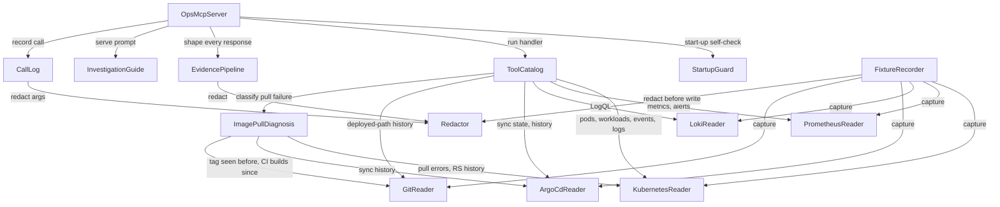

# Components: ops assistant MCP server

Intent: `ops-assistant` · Stage: Domain Design · Date: 2026-10-16

These are the logical building blocks of the read-only incident-evidence MCP server specified in `requirements.md`. They are **code we write**. The Kubernetes API, Prometheus, Loki, Argo CD, the local Git repository and the Claude Code client are external dependencies, not components. All of them live in a new top-level Python package, `ops_mcp/` [Q7]. They never import the existing `app/` package (the Uptime Monitor, `codekb/component-inventory.md`).

Decisions behind these boundaries are recorded as ADRs in `decisions.md`. Requirement IDs (`FR`, `NFR`) refer to `requirements.md`.

## Component Catalogue

```yaml
components:
  - name: OpsMcpServer
    summary: The MCP protocol adapter (stdio). It registers the tools and the investigation prompt, dispatches calls, and is the only place a response leaves the server.
    behaviour: >
      Speaks MCP over stdio to Claude Code, its only client (FR1.1). Before it serves anything, it runs StartupGuard
      and exits with StartupGuard's error if the guard fails (FR1.3, NFR1.2). For every tool call it looks up the
      handler in ToolCatalog, runs it under the 5-second budget (NFR3, NFR5), and hands the handler's structured
      result to EvidencePipeline. It returns ONLY what EvidencePipeline produces: there is no code path that turns a
      handler result into response text without going through the pipeline (FR7.1, ADR-003). It records every call
      in CallLog with its outcome. It serves the InvestigationGuide prompt (FR1.6). It makes no AI calls (FR1.2) and
      exposes no tool that writes to the cluster, Git or GitHub (FR10.3).
    responsibilities:
      - MCP stdio transport, tool and prompt registration, and request dispatch
      - Enforcing the per-call time budget and turning a timeout into a clear error (NFR5)
      - Routing every handler result through EvidencePipeline before responding
      - Refusing to start when StartupGuard fails
    depends_on:
      - component: StartupGuard
        interaction: verify the dedicated kubeconfig and the read-only identity before serving
        style: sync
      - component: ToolCatalog
        interaction: resolve and run the handler for each tool call
        style: sync
      - component: EvidencePipeline
        interaction: redact, shape and wrap every handler result into the response
        style: sync
      - component: InvestigationGuide
        interaction: fetch the investigation prompt it serves
        style: sync
      - component: CallLog
        interaction: record each tool call's metadata and outcome
        style: sync
    dependents: []
    external_dependencies:
      - name: Claude Code (MCP client)
        kind: other
        purpose: the operator's session that calls the tools over stdio
    entities:
      - name: ToolCall
        identifier: call_id
        attributes: [call_id, tool_name, arguments, started_at, deadline]
        references:
          - entity: ToolDefinition
            owned_by: ToolCatalog
            relationship: each ToolCall invokes one ToolDefinition

  - name: StartupGuard
    summary: Fail-closed startup check that the server runs only with its own dedicated, read-only cluster identity.
    behaviour: >
      Reads the kubeconfig path ONLY from the dedicated setting or environment variable. It refuses to start if that is
      unset, or if it would fall back to the default ~/.kube/config or the operator's admin context (FR1.3). It
      checks its own permissions with SelfSubjectAccessReview and SelfSubjectRulesReview, the only write-shaped
      calls the server ever makes (NFR1.2). It fails if the identity can get, list or watch secrets, or can create,
      update, patch or delete anything, or can use pods/exec, attach or portforward. Its error names the excess
      permission. It also checks the presence of the read permissions the tools need, and reports missing ones as
      degraded sources rather than failing (NFR6).
    responsibilities:
      - Resolving and validating the dedicated kubeconfig
      - The permission self-check, with fail-closed refusal on any excess permission
      - Reporting which evidence sources are readable at start
    depends_on: []
    dependents:
      - component: OpsMcpServer
        interaction: gate server start-up on a passing self-check
    external_dependencies:
      - name: Kubernetes API server (minikube)
        kind: third-party-api
        purpose: SelfSubjectAccessReview / SelfSubjectRulesReview
      - name: Dedicated read-only kubeconfig + ServiceAccount
        kind: other
        purpose: the server's only cluster identity (manifests provided under FR1.4)
    entities:
      - name: PermissionReport
        identifier: checked_at
        attributes: [checked_at, service_account, kubeconfig_path, excess_permissions, missing_read_permissions, verdict]

  - name: ToolCatalog
    summary: The investigation tools, namely the fine-grained per-question tools plus a namespace overview, and how each one composes the readers and the diagnosis.
    behaviour: >
      Defines each tool's name, description, arguments and handler [Q5]. The tools are list_pods, describe_pod,
      list_workloads, find_image_users, get_events, get_logs, query_loki, query_prometheus, get_alerts,
      get_argocd_app, git_history and diagnose_image_pull, plus namespace_overview as the recommended first call.
      namespace_overview returns unhealthy pods, non-ready workloads, recent Warning events and the Argo CD
      sync/health state in one response within 10 KB. Every tool takes an explicit time window and an optional
      "as of" time, and never assumes the wall clock (NFR8). find_image_users reports every workload sharing an image
      reference (FR2.4). Handlers return structured evidence records, never text (ADR-003). A failing reader yields a
      per-source error record while the others still answer (NFR6, NFR7). No tool writes anything (FR10.3).
    responsibilities:
      - The tool surface and argument validation
      - Composing readers for composite tools (namespace_overview, find_image_users)
      - Marking per-source failures and "no data in window" results distinctly
    depends_on:
      - component: KubernetesReader
        interaction: pods, workloads, events and container logs
        style: sync
      - component: PrometheusReader
        interaction: metric queries and alerts
        style: sync
      - component: LokiReader
        interaction: LogQL queries
        style: sync
      - component: ArgoCdReader
        interaction: Application sync, health and history
        style: sync
      - component: GitReader
        interaction: history and diffs of the deployed paths, plus clone freshness
        style: sync
      - component: ImagePullDiagnosis
        interaction: classify image-pull failures for diagnose_image_pull and the overview
        style: sync
    dependents:
      - component: OpsMcpServer
        interaction: run the handler for each tool call
    external_dependencies: []
    entities:
      - name: ToolDefinition
        identifier: tool_name
        attributes: [tool_name, description, arguments, default_window, readers_used]

  - name: KubernetesReader
    summary: Read-only access to pods, workloads, events and container logs through the Kubernetes API.
    behaviour: >
      Uses only get, list and watch on pods, pods/log, events, deployments, replicasets, jobs and cronjobs (NFR1). It never reads
      Secrets (FR7.2), and reports environment variables by name and source kind only, never by value (FR2.2). It
      returns the EXACT image-pull waiting or terminated message, unshortened (FR2.5). It includes old and new
      ReplicaSets with their images and readiness, so partial rollouts and post-revert history are visible
      (FR2.7). It reports "no events in <window>" separately from read failures (FR3.2), and "container has not
      started; no logs exist" for never-started containers (FR4.3). Each record carries its object reference and
      timestamps for evidence citation (FR8.2). It reads from a live client or from a FixtureSet (CI replay, NFR10).
    responsibilities:
      - Pod, workload (Deployment, ReplicaSet, CronJob, Job), event and container-log reads
      - Exact pull-error capture and ReplicaSet history
      - Distinguishing empty, not-started and failed reads
    depends_on: []
    dependents:
      - component: ToolCatalog
        interaction: pods, workloads, events and logs for the tools
      - component: ImagePullDiagnosis
        interaction: pull errors and ReplicaSet image history
      - component: FixtureRecorder
        interaction: capture live cluster state for fixtures
    external_dependencies:
      - name: Kubernetes API server (minikube)
        kind: third-party-api
        purpose: read-only resource and log reads with the dedicated ServiceAccount
    entities:
      - name: PodSnapshot
        identifier: namespace/pod_name@observed_at
        attributes: [namespace, pod_name, phase, ready, restarts, owner, containers, images, waiting_reason, waiting_message, observed_at]
      - name: WorkloadSnapshot
        identifier: namespace/kind/name@observed_at
        attributes: [namespace, kind, name, images, desired, updated, ready, available, last_schedule, last_success, replicaset_history, observed_at]
      - name: KubeEvent
        identifier: namespace/uid
        attributes: [type, reason, message, count, first_timestamp, last_timestamp, involved_object]
        references:
          - entity: PodSnapshot
            owned_by: KubernetesReader
            relationship: an event's involved object may be a pod
      - name: ContainerLogExcerpt
        identifier: namespace/pod/container@window
        attributes: [pod, container, previous, window, lines, not_started]

  - name: PrometheusReader
    summary: Read-only PromQL queries and current alerts from the cluster's Prometheus.
    behaviour: >
      Issues only HTTP GET requests, and only to /api/v1/query, /api/v1/query_range and /api/v1/alerts (NFR1.3). Any
      other method or path is a programming error that fails its unit test. Queries take an explicit time or window
      (NFR8). Oversized results are reduced by aggregation or by keeping the most recent points, and the reduction is
      described (FR5.3). An unreachable Prometheus yields an error record naming the source (NFR6). The transport is
      the read-only path chosen in design (OQ1), never the operator's admin credentials.
    responsibilities:
      - Instant and range queries, plus ALERTS with state and active-since time
      - GET-only HTTP client limited to the allow-listed endpoints
    depends_on: []
    dependents:
      - component: ToolCatalog
        interaction: query_prometheus, get_alerts and overview metrics
      - component: FixtureRecorder
        interaction: capture metric series for fixtures
    external_dependencies:
      - name: Prometheus (kube-prometheus-stack, minikube)
        kind: third-party-api
        purpose: metric series and alert state
    entities:
      - name: MetricSeries
        identifier: query@evaluated_at
        attributes: [query, labels, samples, evaluated_at, reduced]
      - name: AlertState
        identifier: alertname+labels
        attributes: [alertname, labels, state, active_since]

  - name: LokiReader
    summary: Read-only LogQL queries against the cluster's Loki.
    behaviour: >
      Issues only HTTP GET requests, and only to /loki/api/v1/query_range and /loki/api/v1/labels (NFR1.3). It takes an explicit window
      (NFR8), returns matching lines with timestamps and labels (FR4.2), says "no log lines in <window>" when nothing
      matches (NFR7), and returns an error naming Loki when it is unreachable or not installed (NFR6).
    responsibilities:
      - LogQL range queries and label listing
    depends_on: []
    dependents:
      - component: ToolCatalog
        interaction: query_loki
      - component: FixtureRecorder
        interaction: capture Loki results for fixtures
    external_dependencies:
      - name: Loki (minikube)
        kind: third-party-api
        purpose: central container logs
    entities:
      - name: LogQueryResult
        identifier: query@window
        attributes: [query, window, streams, lines, empty]

  - name: ArgoCdReader
    summary: Read-only view of Argo CD Applications (sync, health and history) through the Kubernetes API.
    behaviour: >
      Reads applications.argoproj.io with get, list and watch only (NFR1). It never uses the Argo CD API server or its
      credentials (A6). It returns sync status, health, the current revision, the source repo URL, the target branch
      and path, and the bounded sync history (FR6.1). GitReader uses the source repo and branch to detect a mismatch
      with the local clone (FR6.6).
    responsibilities:
      - Application status and sync-history reads
    depends_on: []
    dependents:
      - component: ToolCatalog
        interaction: get_argocd_app and overview sync state
      - component: ImagePullDiagnosis
        interaction: deployment history of an image reference
      - component: FixtureRecorder
        interaction: capture Application state for fixtures
    external_dependencies:
      - name: Kubernetes API server (Argo CD CRDs)
        kind: third-party-api
        purpose: read Application resources in the argocd namespace
    entities:
      - name: ArgoAppState
        identifier: namespace/app_name@observed_at
        attributes: [app_name, sync_status, health_status, revision, source_repo, target_revision, path, history, observed_at]

  - name: GitReader
    summary: Read-only access to the local repository's history for the deployed paths, plus clone-freshness checks.
    behaviour: >
      Runs git only through a fixed allow-list of read-only subcommands (log, show, diff, rev-parse, ls-remote,
      cat-file, for-each-ref, status). It refuses anything else, and any writing flag, before spawning (NFR13,
      FR6.4). Diffs run with --no-ext-diff --no-textconv, so no repo-configured helper can execute. It returns commits
      in a window for the deployed paths (default helm/uptime-monitor/values-gitops.yaml and helm/uptime-monitor/),
      with hash, time, author, subject (which carries the squash-merge PR number) and a size-limited diff (FR6.2). It links an Argo CD
      revision to its commit (FR6.3). Every response states the local HEAD and branch it checked. It warns when the
      clone is behind origin/main, using one read-only `git ls-remote origin refs/heads/main`, or the local origin/main
      ref with its fetch time when the remote is unreachable (FR6.5). An unknown revision is an explicit
      "not in local history; fetch needed" error, and a source-repo or branch mismatch with the Argo CD
      Application is reported (FR6.6).
    responsibilities:
      - Allow-listed, read-only git execution
      - Deployed-path history, diffs and revision-to-commit linking
      - Clone freshness and source-mismatch reporting
    depends_on: []
    dependents:
      - component: ToolCatalog
        interaction: git_history and the revision link in overviews
      - component: ImagePullDiagnosis
        interaction: whether a tag appeared in Git before, and CI-built commits since a SHA
      - component: FixtureRecorder
        interaction: capture the commits for fixtures
    external_dependencies:
      - name: Local Git repository (codespace clone)
        kind: other
        purpose: history of deployed configuration
      - name: GitHub remote (origin)
        kind: third-party-api
        purpose: the single read-only ls-remote freshness check
    entities:
      - name: CommitRecord
        identifier: sha
        attributes: [sha, committed_at, author, subject, pr_number, paths_changed, diff_excerpt]
      - name: CloneStatus
        identifier: head_sha@checked_at
        attributes: [head_sha, branch, origin_main_sha, behind_by, compared_with, last_fetch_at, checked_at]

  - name: ImagePullDiagnosis
    summary: Deterministic classification of image-pull failures and tag history, returned with the evidence it used.
    behaviour: >
      For a failing image reference it classifies the pull error from the exact message as not_found, unauthorized
      or other (FR2.5). For not_found it classifies the tag history as never_existed, likely_deleted_by_lifecycle or
      undetermined, using only evidence available without registry access (FR2.6). That evidence is earlier
      ReplicaSets with Ready pods, Argo CD history and Git history of the deployed files ("seen before"), and
      whether the tag is a commit SHA on main, plus the count of CI-built commits on main since that SHA, compared
      with the lifecycle policy's 5 kept images. When the signals do not settle it, the result is "undetermined
      without registry access". It reports partial impact (old ReplicaSet still serving) and lists every workload
      using the image (FR2.7, FR2.4). Each conclusion lists the evidence references it rests on (FR8.2). The logic is
      pure over reader records, so CI tests it on fixtures [Q1].
    responsibilities:
      - Pull-error kind classification
      - Tag-history classification against the ECR lifecycle policy
      - Partial-failure and shared-image impact assessment
    depends_on:
      - component: KubernetesReader
        interaction: pull messages, ReplicaSet history, workloads sharing the image
        style: sync
      - component: ArgoCdReader
        interaction: sync history of the image reference
        style: sync
      - component: GitReader
        interaction: whether the tag appeared in Git before, and CI-built commits on main since the SHA
        style: sync
    dependents:
      - component: ToolCatalog
        interaction: diagnose_image_pull and the overview's diagnosis line
    external_dependencies: []
    entities:
      - name: PullDiagnosis
        identifier: image_ref@diagnosed_at
        attributes: [image_ref, pull_error_kind, tag_history, impact, affected_workloads, evidence_refs, diagnosed_at]
        references:
          - entity: PodSnapshot
            owned_by: KubernetesReader
            relationship: each diagnosis cites the failing pods it was derived from
          - entity: CommitRecord
            owned_by: GitReader
            relationship: a diagnosis may cite the commit that introduced the tag

  - name: Redactor
    summary: The single redaction engine. It replaces secrets and public IPs with typed markers and never touches evidence identifiers.
    behaviour: >
      Applies the redaction rules to structured values and text. The rules cover connection-string credentials,
      password/secret/token/api_key pairs, Secret-style env values, bearer tokens and JWTs, AWS keys, PEM blocks,
      dockerconfigjson auth, the base64 forms of these, and public IPs. Each match becomes [REDACTED:<kind>] (FR7.3, FR7.5).
      Private IP ranges are kept. A protected-token rule guarantees that image references and tags, commit hashes,
      PR numbers, object names, labels, event reasons and metric names are never redacted (FR7.6). It returns a count
      per kind (FR7.4). It is the same code for tool output, call-log arguments and fixtures (NFR10.2).
    responsibilities:
      - Redaction rules and the protected-identifier rule
      - Redaction counts per kind
    depends_on: []
    dependents:
      - component: EvidencePipeline
        interaction: redact every tool result before shaping
      - component: CallLog
        interaction: redact tool-call arguments before logging
      - component: FixtureRecorder
        interaction: redact captured fixtures before writing
    external_dependencies: []
    entities:
      - name: RedactionRule
        identifier: kind
        attributes: [kind, pattern, marker, applies_to]
      - name: RedactionResult
        identifier: result_id
        attributes: [result_id, counts_by_kind, total]

  - name: EvidencePipeline
    summary: The mandatory output path. It redacts, then shapes and truncates, then wraps in the evidence header, and produces the only text the server returns.
    behaviour: >
      Takes a handler's structured result and, in this fixed order:
        (1) redacts it with Redactor (FR7.1, FR7.7);
        (2) orders items unhealthy first (failing pods, Warning events, non-ready workloads), then most recent;
        (3) truncates or aggregates to at most 10 KB, with a note naming what was dropped and how to narrow the
            query (NFR3);
        (4) prepends the evidence header: tool, source, exact query or object, window, retrieved-at, and the
            redaction count (FR8.1, FR7.4).
      The header and count are never dropped. Exact pull-error messages are never shortened (FR2.5). Error and
      no-data results go through the same path, so they are redacted too.
    responsibilities:
      - Redact-then-shape ordering
      - Prioritised truncation and size enforcement
      - Evidence header and stable evidence references
    depends_on:
      - component: Redactor
        interaction: redaction of every result
        style: sync
    dependents:
      - component: OpsMcpServer
        interaction: turn each handler result into the MCP response
    external_dependencies: []
    entities:
      - name: EvidenceEnvelope
        identifier: envelope_id
        attributes: [envelope_id, tool_name, source, query_or_object, window, retrieved_at, redaction_count, truncated_note, items]
        references:
          - entity: ToolCall
            owned_by: OpsMcpServer
            relationship: each envelope answers one ToolCall
          - entity: RedactionResult
            owned_by: Redactor
            relationship: each envelope carries one redaction result

  - name: InvestigationGuide
    summary: The investigation MCP prompt, plus the operator setup guide and the settings template that ship with it.
    behaviour: >
      Serves the investigation prompt (for example /mcp__ops__investigate) [Q6]. It tells the session to:
      gather cluster evidence only through these tools, starting with namespace_overview, and report gaps instead
      of trying other routes (FR11.3); report in the FR9 format (likely cause with a high/medium/low confidence and
      reason, visible and hidden impact, timeline, cited evidence, proposed fix, follow-ups); label unsupported
      claims as hypotheses (FR9.2); propose detection follow-ups as PR ideas only (FR9.3); and prepare a fix as a
      local branch and commit without pushing (FR10.1, FR10.2). It is versioned with the tool names it refers to.
      It also owns the operator guide and the copyable `.claude/settings.local.json` template with the deny rules
      for kubectl, helm, aws and minikube and no Bash allow rules. The guide states that the server identity, not
      the session settings, is the hard guarantee (FR11.1, FR11.2, FR11.4).
    responsibilities:
      - The investigation prompt text and its report format
      - The operator setup guide and the session settings template
    depends_on: []
    dependents:
      - component: OpsMcpServer
        interaction: serve the prompt to Claude Code
    external_dependencies: []
    entities:
      - name: PromptTemplate
        identifier: prompt_name@version
        attributes: [prompt_name, version, arguments, tool_names_referenced, report_sections]

  - name: CallLog
    summary: A local, append-only record of every tool call, for the server's own health and error rate.
    behaviour: >
      Writes one line per tool call to a local file, never to the cluster. Each line holds the tool, the arguments
      redacted by Redactor, the duration, bytes returned, the redaction count and the outcome (ok, empty, error or
      timeout) (NFR9). The NFR11 live-run check reads it to confirm that only read calls were made.
    responsibilities:
      - Tool-call logging with redacted arguments
    depends_on:
      - component: Redactor
        interaction: redact arguments before writing
        style: sync
    dependents:
      - component: OpsMcpServer
        interaction: record each call and its outcome
    external_dependencies:
      - name: Local file system (codespace)
        kind: other
        purpose: the call-log file
    entities:
      - name: CallRecord
        identifier: call_id
        attributes: [call_id, tool_name, redacted_arguments, duration_ms, bytes_returned, redaction_count, outcome]
        references:
          - entity: ToolCall
            owned_by: OpsMcpServer
            relationship: each CallRecord records one ToolCall

  - name: FixtureRecorder
    summary: A hand-run script that captures a game day's evidence through the real readers and writes redacted fixtures for CI.
    behaviour: >
      Run by the operator during or just after a game day. It calls the same readers the tools use, passes every
      captured record through Redactor, and writes the redacted results as fixture files under tests/ (NFR10,
      NFR10.2) [Q4]. It is not an MCP tool and is not reachable from the server. It also produces the named fixture
      variants (auth failure, lifecycle-deleted tag, partial failure, after revert) by deriving them from a recorded
      base and passing them through the same redaction. In CI, the readers' fixture backends replay these
      FixtureSets with no cluster.
    responsibilities:
      - Capturing live evidence into fixtures
      - Redacting fixtures with the same Redactor before writing
      - Producing the scenario variants
    depends_on:
      - component: KubernetesReader
        interaction: capture pods, workloads, events and logs
        style: sync
      - component: PrometheusReader
        interaction: capture metric series and alerts
        style: sync
      - component: LokiReader
        interaction: capture Loki results
        style: sync
      - component: ArgoCdReader
        interaction: capture Application state
        style: sync
      - component: GitReader
        interaction: capture the relevant commits
        style: sync
      - component: Redactor
        interaction: redact everything before it is written
        style: sync
    dependents: []
    external_dependencies:
      - name: Repository tests/ directory
        kind: other
        purpose: where redacted fixtures are written (committed via PR)
    entities:
      - name: FixtureSet
        identifier: scenario_name
        attributes: [scenario_name, recorded_at, source_commit, files, variant_of]
```

## Component Diagram



Text fallback:
- OpsMcpServer → StartupGuard, ToolCatalog, EvidencePipeline, InvestigationGuide, CallLog.
- ToolCatalog → KubernetesReader, PrometheusReader, LokiReader, ArgoCdReader, GitReader, ImagePullDiagnosis.
- ImagePullDiagnosis → KubernetesReader, ArgoCdReader, GitReader.
- EvidencePipeline → Redactor; CallLog → Redactor.
- FixtureRecorder → all five readers and Redactor. It is a separate entry point, not called by the server.

The graph is acyclic.

## Component Summary

| Component | Purpose | Depends On | Dependents | Entities Owned |
|---|---|---|---|---|
| OpsMcpServer | MCP stdio adapter, dispatch, only response path | StartupGuard, ToolCatalog, EvidencePipeline, InvestigationGuide, CallLog | none | ToolCall |
| StartupGuard | Fail-closed identity and kubeconfig self-check | none | OpsMcpServer | PermissionReport |
| ToolCatalog | Investigation tools and composition | KubernetesReader, PrometheusReader, LokiReader, ArgoCdReader, GitReader, ImagePullDiagnosis | OpsMcpServer | ToolDefinition |
| KubernetesReader | Pods, workloads, events, container logs | none | ToolCatalog, ImagePullDiagnosis, FixtureRecorder | PodSnapshot, WorkloadSnapshot, KubeEvent, ContainerLogExcerpt |
| PrometheusReader | GET-only PromQL and alerts | none | ToolCatalog, FixtureRecorder | MetricSeries, AlertState |
| LokiReader | GET-only LogQL | none | ToolCatalog, FixtureRecorder | LogQueryResult |
| ArgoCdReader | Argo CD Application state via CRDs | none | ToolCatalog, ImagePullDiagnosis, FixtureRecorder | ArgoAppState |
| GitReader | Allow-listed read-only git, clone freshness | none | ToolCatalog, ImagePullDiagnosis, FixtureRecorder | CommitRecord, CloneStatus |
| ImagePullDiagnosis | Deterministic pull-failure and tag-history classification | KubernetesReader, ArgoCdReader, GitReader | ToolCatalog | PullDiagnosis |
| Redactor | Single redaction engine with protected identifiers | none | EvidencePipeline, CallLog, FixtureRecorder | RedactionRule, RedactionResult |
| EvidencePipeline | Redact, then shape and truncate, then header | Redactor | OpsMcpServer | EvidenceEnvelope |
| InvestigationGuide | MCP prompt, operator guide, settings template | none | OpsMcpServer | PromptTemplate |
| CallLog | Local per-call log | Redactor | OpsMcpServer | CallRecord |
| FixtureRecorder | Hand-run redacted fixture capture | the five readers, Redactor | none | FixtureSet |

## Entity Ownership

| Entity | Owning Component | Identifier | Attributes | References |
|---|---|---|---|---|
| ToolCall | OpsMcpServer | call_id | call_id, tool_name, arguments, started_at, deadline | ToolDefinition (ToolCatalog) |
| PermissionReport | StartupGuard | checked_at | checked_at, service_account, kubeconfig_path, excess_permissions, missing_read_permissions, verdict | none |
| ToolDefinition | ToolCatalog | tool_name | tool_name, description, arguments, default_window, readers_used | none |
| PodSnapshot | KubernetesReader | namespace/pod_name@observed_at | namespace, pod_name, phase, ready, restarts, owner, containers, images, waiting_reason, waiting_message, observed_at | none |
| WorkloadSnapshot | KubernetesReader | namespace/kind/name@observed_at | namespace, kind, name, images, desired, updated, ready, available, last_schedule, last_success, replicaset_history, observed_at | none |
| KubeEvent | KubernetesReader | namespace/uid | type, reason, message, count, first_timestamp, last_timestamp, involved_object | PodSnapshot (KubernetesReader) |
| ContainerLogExcerpt | KubernetesReader | namespace/pod/container@window | pod, container, previous, window, lines, not_started | none |
| MetricSeries | PrometheusReader | query@evaluated_at | query, labels, samples, evaluated_at, reduced | none |
| AlertState | PrometheusReader | alertname+labels | alertname, labels, state, active_since | none |
| LogQueryResult | LokiReader | query@window | query, window, streams, lines, empty | none |
| ArgoAppState | ArgoCdReader | namespace/app_name@observed_at | app_name, sync_status, health_status, revision, source_repo, target_revision, path, history, observed_at | none |
| CommitRecord | GitReader | sha | sha, committed_at, author, subject, pr_number, paths_changed, diff_excerpt | none |
| CloneStatus | GitReader | head_sha@checked_at | head_sha, branch, origin_main_sha, behind_by, compared_with, last_fetch_at, checked_at | none |
| PullDiagnosis | ImagePullDiagnosis | image_ref@diagnosed_at | image_ref, pull_error_kind, tag_history, impact, affected_workloads, evidence_refs, diagnosed_at | PodSnapshot (KubernetesReader), CommitRecord (GitReader) |
| RedactionRule | Redactor | kind | kind, pattern, marker, applies_to | none |
| RedactionResult | Redactor | result_id | result_id, counts_by_kind, total | none |
| EvidenceEnvelope | EvidencePipeline | envelope_id | envelope_id, tool_name, source, query_or_object, window, retrieved_at, redaction_count, truncated_note, items | ToolCall (OpsMcpServer), RedactionResult (Redactor) |
| PromptTemplate | InvestigationGuide | prompt_name@version | prompt_name, version, arguments, tool_names_referenced, report_sections | none |
| CallRecord | CallLog | call_id | call_id, tool_name, redacted_arguments, duration_ms, bytes_returned, redaction_count, outcome | ToolCall (OpsMcpServer) |
| FixtureSet | FixtureRecorder | scenario_name | scenario_name, recorded_at, source_commit, files, variant_of | none |

## External Dependencies

| Component | Dependency | Kind | Purpose |
|---|---|---|---|
| OpsMcpServer | Claude Code (MCP client) | other | The operator's session calling the tools over stdio |
| StartupGuard | Kubernetes API server (minikube) | third-party-api | Permission self-check |
| StartupGuard | Dedicated read-only kubeconfig + ServiceAccount | other | The server's only cluster identity |
| KubernetesReader | Kubernetes API server (minikube) | third-party-api | Read-only resource and log reads |
| PrometheusReader | Prometheus (minikube) | third-party-api | Metric series and alerts (GET only) |
| LokiReader | Loki (minikube) | third-party-api | Container logs (GET only) |
| ArgoCdReader | Kubernetes API server (Argo CD CRDs) | third-party-api | Application resources |
| GitReader | Local Git repository | other | Deployed-configuration history |
| GitReader | GitHub remote (origin) | third-party-api | One read-only ls-remote freshness check |
| CallLog | Local file system | other | Call-log file |
| FixtureRecorder | Repository tests/ directory | other | Redacted fixture output |

## Rationale

| Component | Why it is a separate building block |
|---|---|
| OpsMcpServer | A distinct concern: the protocol and dispatch. Keeping it thin makes "every response passes the pipeline" a property of one small file (ADR-003) |
| StartupGuard | A distinct lifecycle (runs once, before serving) and a security boundary that must fail closed. It is tested on its own against admin and read-only identities (ADR-008) |
| ToolCatalog | The tool surface changes at a different rate from data access. Composite tools (the overview) need a home that is not a reader (ADR-005) |
| KubernetesReader, PrometheusReader, LokiReader, ArgoCdReader, GitReader | One per source: each has its own failure mode, timeout, access rule (RBAC verbs, GET-only HTTP, git allow-list) and fixture backend, so NFR6 degradation and the NFR1.3 and NFR13 tests are per source (ADR-002) |
| ImagePullDiagnosis | Distinct business logic. It is the only judgement inside the server and must be CI-testable as pure logic over reader records (ADR-001) |
| Redactor | The highest-risk logic. It is shared by three callers that must behave identically (output, logs, fixtures) and has its own large test suite (ADR-003, ADR-004) |
| EvidencePipeline | A distinct concern: ordering, truncation and headers. Its fixed redact-then-shape order is a correctness rule (FR7.7) that belongs in one place (ADR-003) |
| InvestigationGuide | Distinct content with its own change rate (wording and report format). It is versioned with the tool names it cites (ADR-006) |
| CallLog | A distinct concern: the server's own observability, written locally (NFR9) |
| FixtureRecorder | A distinct lifecycle (run by hand, writes to the repo). It is kept out of the server so the server stays write-free (ADR-004) |

**Alternatives rejected** (details in `decisions.md`):
- Diagnosis only in the session (not testable in CI).
- Readers grouped by access path or by question.
- Redaction inside each reader.
- A record mode inside the server, or hand-written fixtures.
- Only a few broad tools.
- A project skill as the entry point.
- Placing the code inside `app/` or in a separate project directory.

## Integration with the Existing System

- **No code coupling:** `ops_mcp/` does not import `app/`. Its tests live under `tests/ops_mcp/` and use the repo's existing `pytest` and `ruff` setup and CI workflow [Q7] [`codekb/code-structure.md`].
- **The existing system is only observed:** Uptime API, Checker CronJob, PostgreSQL, the Helm chart, the Argo CD Application `uptime` and the monitoring stack are observed read-only, through the readers above [`codekb/component-inventory.md`]. Nothing in them changes for this work, except the new RBAC manifests and the MCP registration (FR1.1, FR1.4), which Infrastructure Design covers.
- **Image tag knowledge:** the deployed-path defaults in GitReader come from `codekb/code-structure.md` § "Where the image tag is set".

## Sources

- `aidlc/spaces/default/intents/261015-ops-assistant/inception/requirements-analysis/requirements.md` (FR1–FR11, NFR1–NFR13, A1–A6, OQ1–OQ4)
- `domain-design-questions.md` Q1–Q7 [Q1]–[Q7]
- `aidlc/spaces/default/codekb/aws-k8s-platform/architecture.md`, `component-inventory.md`, `code-structure.md`

## Assumptions & Open Questions

- The read-only transport to Prometheus and Loki (OQ1), how the ServiceAccount is placed and its token issued (OQ2), and the redaction false-positive policy (OQ4) are still open. They are left to the NFR and Infrastructure Design stages. None of them changes a component boundary. OQ3 is resolved by Q6: the entry point is an MCP prompt.
- Concrete tool argument schemas, entity data types and the prompt wording belong to Functional Design.
