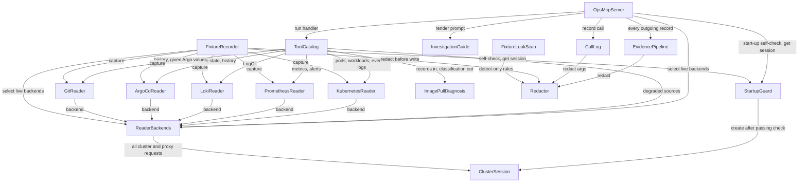

# Components: ops assistant MCP server

Intent: `ops-assistant` · Stage: Domain Design · Date: 2026-10-25

These are the logical building blocks of the read-only incident-evidence MCP server specified in `requirements.md`. They are **code we write**. The Kubernetes API, Prometheus, Loki, Argo CD, the local Git repository and the Claude Code client are external dependencies, not components. All of them live in a new top-level Python package, `ops_mcp/` [Q7]. They never import the existing `app/` package (the Uptime Monitor, `codekb/component-inventory.md`).

Decisions behind these boundaries are recorded as ADRs in `decisions.md`. Requirement IDs (`FR`, `NFR`) refer to `requirements.md`. `[gate]` marks a decision the operator made at the Domain Design approval gate on 2026-10-25.

## Component Catalogue

```yaml
components:
  - name: OpsMcpServer
    summary: The MCP protocol adapter (stdio). It is the composition root and the only place a byte leaves the server on stdout.
    behaviour: >
      Speaks MCP over stdio to Claude Code, its only client (FR1.1). The adapter receives its reader backends and
      its ToolCatalog through its constructor and never builds them itself. Only the production entry point runs
      StartupGuard; a passing guard yields a ClusterSession, which the entry point hands to ReaderBackends.live to
      build the live backends and then passes them to the adapter. The adapter has no fixture switch and cannot enter
      fixture mode on its own: the test harness constructs the same adapter with ReaderBackends.fixture(set_dir)
      backends, so the stdout/stderr capture, the Redactor-raises frame and the catch-all tests run without a
      cluster (ADR-011). For every tool
      call it looks up the handler in ToolCatalog and runs it under the 5-second budget (NFR3, NFR5).
      Single exit (ADR-003): every outgoing message, including handler results, empty results, timeout errors,
      argument-validation errors, unknown-tool errors, any exception and the rendered investigation prompt, is built
      as a structured record and passed through EvidencePipeline. There is no exempt output. The stdio adapter has a
      catch-all around request handling that turns any uncaught exception into an error record (tool name and a fixed
      error kind, never the exception text unredacted) and sends it through the same pipeline.
      Fail closed: if EvidencePipeline or Redactor itself raises, the adapter does not call them again. It sends a
      constant, pre-built error frame with no variable text; the only variable it may carry is a tool name taken from
      ToolCatalog's closed list. It then records the failure in CallLog through Redactor; if that also fails, it
      records nothing. A test makes Redactor raise and checks that the client receives exactly that frame. The
      constant frame is defined in, and written only by, the transport module, so the static stdout check still holds.
      Prompt arguments are validated against the Kubernetes namespace name pattern (a DNS-1123 label, at most 63
      characters) and rejected otherwise, before the prompt is rendered.
      stdout carries only MCP protocol frames, written by the transport alone;
      at start the process stdout is captured by the transport and sys.stdout is replaced by a sink that rejects
      writes. stderr carries only fixed, non-data startup messages from a closed catalogue; the only variable text
      allowed is a permission name taken from StartupGuard's own fixed list of checked verb/resource pairs. Python
      logging has no stream handler: library logs go to CallLog through Redactor or are dropped. It records every
      call in CallLog. It makes
      no AI calls (FR1.2) and exposes no tool that writes to the cluster, Git or GitHub (FR10.3).
    responsibilities:
      - MCP stdio transport, tool and prompt registration, and request dispatch
      - Composition root - the production entry point runs StartupGuard, then ReaderBackends.live, then constructs the adapter with those backends and the ToolCatalog; the test harness constructs it with fixture backends
      - Enforcing the per-call time budget and turning a timeout into an error record (NFR5)
      - Routing every outgoing message, errors and the prompt included, through EvidencePipeline, with a catch-all in the stdio adapter
      - The fail-closed constant error frame when the pipeline or Redactor itself fails
      - Validating prompt arguments as DNS-1123 labels
      - Keeping stdout protocol-only and stderr to fixed startup messages
    depends_on:
      - component: StartupGuard
        interaction: verify the dedicated kubeconfig and the read-only identity, and receive the ClusterSession
        style: sync
      - component: ReaderBackends
        interaction: build the readers' live backends from the verified ClusterSession
        style: sync
      - component: ToolCatalog
        interaction: resolve and run the handler for each tool call
        style: sync
      - component: EvidencePipeline
        interaction: redact, shape and wrap every outgoing record, errors included
        style: sync
      - component: InvestigationGuide
        interaction: render the investigation prompt from validated arguments, then send it through the pipeline
        style: sync
      - component: CallLog
        interaction: record each tool call's metadata and outcome
        style: sync
    dependents: []
    external_dependencies:
      - name: Claude Code (MCP client)
        kind: other
        purpose: the operator's session that calls the tools over stdio
    entities:
      - name: ToolCall
        identifier: call_id
        attributes: [call_id, tool_name, arguments, started_at, deadline]
        references:
          - entity: ToolDefinition
            owned_by: ToolCatalog
            relationship: each ToolCall invokes one ToolDefinition

  - name: StartupGuard
    summary: Fail-closed startup check. It is the only code that loads a kubeconfig, and the only creator of a ClusterSession.
    behaviour: >
      Reads the kubeconfig path ONLY from the dedicated setting or environment variable. It refuses to start if that is
      unset, or if it would fall back to the default ~/.kube/config or the operator's admin context (FR1.3). It
      checks its own permissions with SelfSubjectAccessReview and SelfSubjectRulesReview, the only write-shaped
      calls the server ever makes (NFR1.2). It fails if the identity can get, list or watch secrets, or can create,
      update, patch or delete anything, or can use pods/exec, attach or portforward; its fixed refusal message names
      the excess permission. Only after the check passes does it construct the ClusterSession (ADR-008). It also
      checks the read permissions the tools need, including get on services/proxy for the Prometheus and Loki
      services, and records missing ones as degraded sources on the ClusterSession rather than failing (NFR6).
      Both OpsMcpServer and FixtureRecorder go through it; neither has another way to reach the cluster.
    responsibilities:
      - Resolving and validating the dedicated kubeconfig (the only kubeconfig loader in the package)
      - The permission self-check, with fail-closed refusal on any excess permission
      - Constructing the ClusterSession only after a passing check, carrying the degraded-sources list
    depends_on:
      - component: ClusterSession
        interaction: construct the verified session after the self-check passes
        style: sync
    dependents:
      - component: OpsMcpServer
        interaction: gate server start-up on a passing self-check and obtain the session
      - component: FixtureRecorder
        interaction: gate recording on the same self-check and obtain the session
    external_dependencies:
      - name: Kubernetes API server (minikube)
        kind: third-party-api
        purpose: SelfSubjectAccessReview / SelfSubjectRulesReview
      - name: Dedicated read-only kubeconfig + ServiceAccount
        kind: other
        purpose: the server's only cluster identity (provided by the ReadOnlyIdentityKit, FR1.4)
    entities:
      - name: PermissionReport
        identifier: checked_at
        attributes: [checked_at, service_account, kubeconfig_path, excess_permissions, missing_read_permissions, verdict]

  - name: ClusterSession
    summary: The verified, read-only cluster connection shared by every cluster-facing backend. It can be created only by StartupGuard.
    behaviour: >
      Holds the one authenticated Kubernetes API client built from the dedicated kubeconfig, and the API-server
      service-proxy base paths for Prometheus and Loki in the monitoring namespace (ADR-009). Its constructor is
      private to StartupGuard and requires a passing PermissionReport, so no other code can create one; a static test
      fails if any module other than StartupGuard imports a kubeconfig loader or constructs an API client. Through the
      service proxy it allows only HTTP GET, matching the identity's get-only grant on services/proxy (NFR1.3). It
      carries the degraded-sources list from the startup check, which ToolCatalog reads through ReaderBackends (NFR6).
    responsibilities:
      - Holding the single verified API client and the Prometheus and Loki proxy paths
      - GET-only transport for the service proxy
      - Carrying the degraded-sources list from start-up
    depends_on: []
    dependents:
      - component: StartupGuard
        interaction: creates the session after the self-check passes
      - component: ReaderBackends
        interaction: live backends issue every cluster, Prometheus and Loki request through it
    external_dependencies:
      - name: Kubernetes API server (minikube)
        kind: third-party-api
        purpose: resource reads, and the service proxy to Prometheus and Loki
    entities:
      - name: VerifiedSession
        identifier: session_id
        attributes: [session_id, service_account, api_server, prometheus_proxy_path, loki_proxy_path, degraded_sources, verified_at]

  - name: ReaderBackends
    summary: The single selection point that gives every reader either its live backend or its fixture backend.
    behaviour: >
      Defines one backend interface per reader (Kubernetes, Prometheus, Loki, Argo CD, Git) and two implementations
      of each (ADR-011). live(session, repo_path) builds live backends that reach the cluster only through the
      ClusterSession and run git only through the hardened runner described under GitReader. fixture(set_dir)
      builds fixture backends that read the per-source fixture formats listed in the Fixture Formats table and never
      open a network connection or start a process. This is the only place a mode is chosen; readers receive a backend
      and cannot tell or change which. The live HTTP backends also enforce GET-only and the reader's path allow-list
      (NFR1.3); the live git runner re-checks the subcommand and argv shape before spawning (NFR13). It exposes the
      degraded-sources list (from the session in live mode, from the fixture set in fixture mode) to ToolCatalog.
    responsibilities:
      - The backend interface per reader, with live and fixture implementations
      - The one mode selection point (live with a verified session, or a fixture set)
      - Transport-level enforcement - GET-only HTTP and the git runner allow-list
      - Exposing the degraded-sources list
    depends_on:
      - component: ClusterSession
        interaction: live backends issue every cluster, Prometheus and Loki request through the verified session
        style: sync
    dependents:
      - component: OpsMcpServer
        interaction: select live backends at start-up
      - component: ToolCatalog
        interaction: read the degraded-sources list
      - component: KubernetesReader
        interaction: Kubernetes backend
      - component: PrometheusReader
        interaction: Prometheus backend
      - component: LokiReader
        interaction: Loki backend
      - component: ArgoCdReader
        interaction: Argo CD backend
      - component: GitReader
        interaction: Git backend (hardened runner or transcript replay)
      - component: FixtureRecorder
        interaction: select live backends for recording
    external_dependencies:
      - name: Local git executable
        kind: other
        purpose: the live git runner (read-only plumbing only)
      - name: Fixture files under tests/ops_mcp/fixtures/
        kind: other
        purpose: fixture-mode input
    entities:
      - name: BackendSelection
        identifier: selection_id
        attributes: [selection_id, mode, session_id, fixture_dir, sources, degraded_sources]
        references:
          - entity: VerifiedSession
            owned_by: ClusterSession
            relationship: a live selection uses exactly one verified session

  - name: ToolCatalog
    summary: The investigation tools, namely the fine-grained per-question tools plus a namespace overview, and how each one composes the readers and the diagnosis.
    behaviour: >
      Defines each tool's name, description, arguments and handler [Q5]. The tools are list_pods, describe_pod,
      list_workloads, find_image_users, get_events, get_logs, query_loki, query_prometheus, get_alerts,
      get_argocd_app, git_history and diagnose_image_pull, plus namespace_overview as the recommended first call.
      namespace_overview returns unhealthy pods, non-ready workloads, recent Warning events and the Argo CD
      sync/health state in one response within 10 KB. Every tool takes an explicit time window and an optional
      "as of" time, and never assumes the wall clock (NFR8). find_image_users reports every workload sharing an image
      reference (FR2.4). For revision linking and the branch check it reads ArgoAppState from ArgoCdReader and passes
      its revision and target_revision into the GitReader call as arguments (FR6.3, FR6.6); GitReader never calls
      ArgoCdReader. For diagnose_image_pull and the overview's diagnosis line it makes all the reader calls itself
      (pods, workloads and events from KubernetesReader, ArgoAppState from ArgoCdReader, and the first-parent
      origin/main SHA list and relevant CommitRecords from GitReader) and passes those records into
      ImagePullDiagnosis, which calls no reader. It reads the degraded-sources list from ReaderBackends and answers a tool whose source
      is degraded with a per-source error record without calling the reader (NFR6). Handlers return structured
      evidence records, never text (ADR-003). A failing reader yields a per-source error record while the others still
      answer (NFR6, NFR7). Composite tools call their readers concurrently, each under its own source timeout (see
      Constraints for Functional Design). No tool writes anything (FR10.3).
    responsibilities:
      - The tool surface and argument validation
      - Composing readers for composite tools (namespace_overview, find_image_users)
      - Passing ArgoAppState values into GitReader calls
      - Gathering the reader records ImagePullDiagnosis needs and passing them in
      - Marking degraded sources, per-source failures and "no data in window" results distinctly
    depends_on:
      - component: KubernetesReader
        interaction: pods, workloads, events and container logs
        style: sync
      - component: PrometheusReader
        interaction: metric queries and alerts
        style: sync
      - component: LokiReader
        interaction: LogQL queries
        style: sync
      - component: ArgoCdReader
        interaction: Application sync, health and history
        style: sync
      - component: GitReader
        interaction: history and diffs of the deployed paths, clone freshness, given the ArgoAppState values as arguments
        style: sync
      - component: ImagePullDiagnosis
        interaction: classify image-pull failures from the reader records it is given, for diagnose_image_pull and the overview
        style: sync
      - component: ReaderBackends
        interaction: read the degraded-sources list
        style: sync
    dependents:
      - component: OpsMcpServer
        interaction: run the handler for each tool call
    external_dependencies: []
    entities:
      - name: ToolDefinition
        identifier: tool_name
        attributes: [tool_name, description, arguments, default_window, readers_used]

  - name: KubernetesReader
    summary: Read-only access to pods, workloads, events and container logs through the Kubernetes API.
    behaviour: >
      Uses only get, list and watch on pods, pods/log, events, deployments, replicasets, jobs and cronjobs (NFR1),
      through its backend. It never reads Secrets (FR7.2), and reports environment variables by name and source kind
      only (literal, ConfigMap, Secret), never by value (FR2.2). It returns the EXACT image-pull waiting or terminated
      message, unshortened (FR2.5). It includes old and new ReplicaSets with their images and readiness, so partial
      rollouts and post-revert history are visible (FR2.7). It reports "no events in <window>" separately from read
      failures (FR3.2), and "container has not started; no logs exist" for never-started containers (FR4.3). Each
      record carries its object reference and timestamps for evidence citation (FR8.2).
    responsibilities:
      - Pod, workload (Deployment, ReplicaSet, CronJob, Job), event and container-log reads
      - Exact pull-error capture and ReplicaSet history
      - Distinguishing empty, not-started and failed reads
    depends_on:
      - component: ReaderBackends
        interaction: Kubernetes backend (live through the ClusterSession, or fixture)
        style: sync
    dependents:
      - component: ToolCatalog
        interaction: pods, workloads, events and logs for the tools and for the diagnosis inputs
      - component: FixtureRecorder
        interaction: capture live cluster state for fixtures
    external_dependencies: []
    entities:
      - name: PodSnapshot
        identifier: namespace/pod_name@observed_at
        attributes: [namespace, pod_name, phase, ready, restarts, owner, containers, images, env_refs, waiting_reason, waiting_message, observed_at]
      - name: WorkloadSnapshot
        identifier: namespace/kind/name@observed_at
        attributes: [namespace, kind, name, images, desired, updated, ready, available, last_schedule, last_success, replicaset_history, observed_at]
      - name: KubeEvent
        identifier: namespace/uid
        attributes: [type, reason, message, count, first_timestamp, last_timestamp, involved_object_kind, involved_object_name]
        references:
          - entity: PodSnapshot
            owned_by: KubernetesReader
            relationship: when the involved object is a pod, the event refers to that pod; other kinds are named by kind and name only
      - name: ContainerLogExcerpt
        identifier: namespace/pod/container@window
        attributes: [pod, container, previous, window, lines, not_started]

  - name: PrometheusReader
    summary: Read-only PromQL queries and current alerts from the cluster's Prometheus, through the API-server service proxy.
    behaviour: >
      Issues only HTTP GET requests, and only to /api/v1/query, /api/v1/query_range and /api/v1/alerts behind the
      Prometheus service-proxy path (NFR1.3, ADR-009). Any other method or path fails its unit test, and the live
      backend refuses it. Queries take an explicit time or window (NFR8). Oversized results are reduced by
      aggregation or by keeping the most recent points, and the reduction is described (FR5.3). An unreachable
      Prometheus, or a missing services/proxy grant, yields an error record naming the source (NFR6). It never
      uses the operator's credentials.
    responsibilities:
      - Instant and range queries, plus ALERTS with state and active-since time
      - The GET-only path allow-list for Prometheus
    depends_on:
      - component: ReaderBackends
        interaction: Prometheus backend (GET through the service proxy, or fixture)
        style: sync
    dependents:
      - component: ToolCatalog
        interaction: query_prometheus, get_alerts and overview metrics
      - component: FixtureRecorder
        interaction: capture metric series for fixtures
    external_dependencies: []
    entities:
      - name: MetricSeries
        identifier: query@evaluated_at
        attributes: [query, labels, samples, evaluated_at, reduced]
      - name: AlertState
        identifier: alertname+labels
        attributes: [alertname, labels, state, active_since]

  - name: LokiReader
    summary: Read-only LogQL queries against the cluster's Loki, through the API-server service proxy.
    behaviour: >
      Issues only HTTP GET requests, and only to /loki/api/v1/query_range and /loki/api/v1/labels behind the Loki
      service-proxy path (NFR1.3, ADR-009). It takes an explicit window (NFR8), returns matching lines with
      timestamps and labels (FR4.2), says "no log lines in <window>" when nothing matches (NFR7), and returns an
      error naming Loki when it is unreachable or not installed (NFR6).
    responsibilities:
      - LogQL range queries and label listing
      - The GET-only path allow-list for Loki
    depends_on:
      - component: ReaderBackends
        interaction: Loki backend (GET through the service proxy, or fixture)
        style: sync
    dependents:
      - component: ToolCatalog
        interaction: query_loki
      - component: FixtureRecorder
        interaction: capture Loki results for fixtures
    external_dependencies: []
    entities:
      - name: LogQueryResult
        identifier: query@window
        attributes: [query, window, streams, lines, empty]

  - name: ArgoCdReader
    summary: Read-only view of Argo CD Applications (sync, health and history) through the Kubernetes API.
    behaviour: >
      Reads applications.argoproj.io with get, list and watch only (NFR1), through its backend. It never uses the
      Argo CD API server or its credentials (A6). It returns sync status, health, the current revision, the source repo
      URL, the target branch and path, and the bounded sync history (FR6.1). It does not call GitReader; ToolCatalog
      passes its values to GitReader.
    responsibilities:
      - Application status and sync-history reads
    depends_on:
      - component: ReaderBackends
        interaction: Argo CD backend (live through the ClusterSession, or fixture)
        style: sync
    dependents:
      - component: ToolCatalog
        interaction: get_argocd_app, overview sync state and the diagnosis inputs
      - component: FixtureRecorder
        interaction: capture Application state for fixtures
    external_dependencies: []
    entities:
      - name: ArgoAppState
        identifier: namespace/app_name@observed_at
        attributes: [app_name, sync_status, health_status, revision, source_repo, target_revision, path, history, observed_at]

  - name: GitReader
    summary: Read-only access to the local repository's history for the deployed paths, plus clone-freshness checks, using only read-only git plumbing with fixed argv shapes.
    behaviour: >
      Builds every git command from one of nine fixed argv shapes over four read-only plumbing subcommands, and
      nothing else (NFR13, FR6.4, ADR-002). These are the only calls the live runner executes and the only entries
      the git fixture transcript holds:
        G1 rev-parse HEAD - the HEAD sha;
        G2 rev-parse --abbrev-ref HEAD - the local branch;
        G3 rev-parse --verify --quiet --end-of-options <sha>^{commit} - does this revision exist;
        G4 rev-parse refs/remotes/origin/main - the origin/main sha as of the last fetch;
        G5 rev-list --count HEAD..refs/remotes/origin/main - how far HEAD is behind;
        G6 rev-list --first-parent refs/remotes/origin/main - the first-parent SHAs on origin/main;
        G7 log -g -1 --format=<fixed> refs/remotes/origin/main - the last fetch time from the reflog;
        G8 log --no-ext-diff --no-textconv --format=<fixed> --since=<t> --until=<t> <ref> -- <deployed paths> -
           commits in a window for the deployed paths;
        G9 show --no-ext-diff --no-textconv --format=<fixed> --patch <sha> -- <deployed paths> - one commit's
           metadata and patch for the deployed paths.
      git status, diff, cat-file, for-each-ref, config, ls-remote, fetch and every writing subcommand are not
      available, and no file is ever read at a past commit.
      Refs are validated before use: a 7 to 40 character lowercase hex SHA, or one of the fixed names HEAD and
      refs/remotes/origin/main; nothing starting with "-" is accepted. Paths come from the fixed deployed-path list
      (default helm/uptime-monitor/values-gitops.yaml and helm/uptime-monitor/) and are always placed after "--".
      The live runner (in ReaderBackends) runs git with --no-pager and a scrubbed environment: GIT_OPTIONAL_LOCKS=0,
      GIT_CONFIG_NOSYSTEM=1, GIT_CONFIG_GLOBAL=/dev/null, GIT_TERMINAL_PROMPT=0, no GIT_EXTERNAL_DIFF, and
      -c core.fsmonitor=false -c core.hooksPath=/dev/null -c diff.external= -c log.showSignature=false
      -c protocol.ext.allow=never; log and show also pass --no-ext-diff --no-textconv. So no repo-configured
      helper, hook or signature program can run, and git takes no index lock.
      It returns commits with hash, time, author, subject (which carries the squash-merge PR number) and a
      size-limited patch (FR6.2), and the list of first-parent SHAs on origin/main (G6) as a MainlineHistory record.
      It links an Argo CD revision to its commit using the revision and target_revision that ToolCatalog passes as
      arguments (FR6.3); it never calls ArgoCdReader. Every response states the local HEAD and branch it checked.
      Clone freshness compares HEAD with origin/main as recorded at the last fetch, gives the behind count and the
      last-fetch time from the origin/main reflog ("unknown" if there is none), and says the comparison is only as
      fresh as the last fetch. It never contacts the remote and never fetches (FR6.5). An unknown revision is the
      explicit "not in local history; the clone may be stale (run git fetch)" error. The Argo CD target branch is
      compared with the local branch (G2) only, and a mismatch is reported; a target that is not a branch name is
      reported as "not comparable". The repo URL is not compared (single-repo setup, out of scope) (FR6.6) [gate].
    responsibilities:
      - The nine fixed argv shapes, with ref validation and "--" before paths
      - Deployed-path history, patches, revision-to-commit linking and the first-parent SHA list
      - Clone freshness from local refs only, and the branch check against Argo CD
    depends_on:
      - component: ReaderBackends
        interaction: Git backend (hardened live runner, or transcript replay)
        style: sync
    dependents:
      - component: ToolCatalog
        interaction: git_history, the revision link in overviews, and the first-parent SHA list for the diagnosis
      - component: FixtureRecorder
        interaction: capture the commits for fixtures
    external_dependencies:
      - name: Local Git repository (codespace clone)
        kind: other
        purpose: history of deployed configuration and the origin/main ref as of the last fetch
    entities:
      - name: CommitRecord
        identifier: sha
        attributes: [sha, committed_at, author, subject, pr_number, paths_changed, diff_excerpt]
      - name: CloneStatus
        identifier: head_sha@checked_at
        attributes: [head_sha, branch, origin_main_sha, behind_by, last_fetch_at, compared_with, checked_at]
      - name: MainlineHistory
        identifier: origin_main_sha
        attributes: [origin_main_sha, first_parent_shas, last_fetch_at]

  - name: ImagePullDiagnosis
    summary: Pure, deterministic classification of image-pull failures and tag history from the reader records it is given, returned with the evidence it used.
    behaviour: >
      Pure function: it takes reader records as input (PodSnapshots, WorkloadSnapshots, KubeEvents, ArgoAppState,
      MainlineHistory and CommitRecords), gathered and passed in by ToolCatalog, and calls no reader or anything else.
      For a failing image reference it classifies the pull error from the exact message as not_found, unauthorized
      or other (FR2.5). For not_found it classifies the tag history with one heuristic, using only evidence available
      without registry access (FR2.6) [gate]: likely_deleted_by_lifecycle if the tag is the full 40-character SHA of
      a first-parent commit on origin/main (MainlineHistory), otherwise never_existed. The result is labelled a
      heuristic, with the reason shown (for example "tag is the full SHA of first-parent commit <sha> on origin/main,
      so CI is likely to have built it and the 5-image lifecycle policy may have expired it", or "tag is not a
      first-parent commit SHA on origin/main"). It reads no workflow file and counts no builds. It reports partial
      impact (old ReplicaSet still serving) and lists every workload using the image (FR2.7, FR2.4). Each conclusion
      lists the evidence references it rests on (FR8.2). CI tests it on fixture records [Q1].
    responsibilities:
      - Pull-error kind classification
      - The tag-history heuristic and its stated reason
      - Partial-failure and shared-image impact assessment
    depends_on: []
    dependents:
      - component: ToolCatalog
        interaction: diagnose_image_pull and the overview's diagnosis line
    external_dependencies: []
    entities:
      - name: PullDiagnosis
        identifier: image_ref@diagnosed_at
        attributes: [image_ref, pull_error_kind, tag_history, impact, affected_workloads, evidence_refs, diagnosed_at]
        references:
          - entity: PodSnapshot
            owned_by: KubernetesReader
            relationship: each diagnosis cites the failing pods it was derived from
          - entity: WorkloadSnapshot
            owned_by: KubernetesReader
            relationship: a diagnosis cites the workloads and ReplicaSet history that show impact and "seen before"
          - entity: KubeEvent
            owned_by: KubernetesReader
            relationship: a diagnosis may cite the image-pull events
          - entity: ArgoAppState
            owned_by: ArgoCdReader
            relationship: a diagnosis may cite the sync history that deployed the tag
          - entity: CommitRecord
            owned_by: GitReader
            relationship: a diagnosis may cite the commit that introduced the tag
          - entity: MainlineHistory
            owned_by: GitReader
            relationship: the tag-history heuristic cites the first-parent SHA list it checked

  - name: Redactor
    summary: The single redaction engine. It replaces secrets and public IPs with typed markers and never touches the protected identifier fields.
    behaviour: >
      Redaction contract (ADR-010):
        (1) Protection is by field position, not by pattern. Every evidence record declares its protected identifier
            fields - image references and tags, commit SHAs, PR numbers, object kinds, names, namespaces and UIDs,
            event reasons, metric names and label keys. Those field values are never scanned or changed (FR7.6).
        (2) Every other field is scanned, including label values. Inside label values the secret and public-IP rules
            apply and win (FR7.5).
        (3) Multi-line values (log lines, patch excerpts, event and pull messages) are joined with newlines and
            scanned as one text, so PEM blocks, base64 blobs and other secrets spanning lines are caught; counts come
            from that joined pass.
        (4) The rules cover connection-string credentials, password/secret/token/api_key pairs, Secret-style env
            values, bearer tokens and JWTs, AWS access key IDs and secret keys, PEM blocks, dockerconfigjson auth, the
            base64 forms of these, and public IPs. Private ranges are kept. Each match becomes [REDACTED:<kind>]
            (FR7.3, FR7.5). The AWS secret-key rule needs either an AWS key name next to the value or at least one
            character outside lowercase hex, so a 40-character commit SHA in free text is not mistaken for a key.
      It returns a count per kind (FR7.4). It is the same code for tool output, call-log arguments, fixtures and the
      fixture leak scan (NFR10.2). It also owns the seeded sample set for its test suite: obviously fake values only,
      stored apart from recorded fixtures. That set includes a commit SHA beside a real-shaped AWS secret key, and the
      test checks the SHA survives and the key is redacted (NFR2).
    responsibilities:
      - The redaction contract - positional protection, joined-text scanning, rule set
      - Redaction counts per kind
      - The seeded fake-sample set for the redaction tests
    depends_on: []
    dependents:
      - component: EvidencePipeline
        interaction: redact every outgoing record before shaping
      - component: CallLog
        interaction: redact tool-call arguments and library log lines before writing
      - component: FixtureRecorder
        interaction: redact captured and edited fixtures before writing
      - component: FixtureLeakScan
        interaction: detect secret-shaped values in committed fixtures using the same rules
    external_dependencies: []
    entities:
      - name: RedactionRule
        identifier: kind
        attributes: [kind, pattern, marker, applies_to]
      - name: RedactionResult
        identifier: result_id
        attributes: [result_id, counts_by_kind, total]
      - name: SeededSampleSet
        identifier: sample_set_id
        attributes: [sample_set_id, kinds, files, fake_marker]

  - name: EvidencePipeline
    summary: The mandatory output path. It redacts, then shapes and truncates, then wraps in the evidence header, and produces the only text the server returns.
    behaviour: >
      Takes any outgoing structured record (a handler result, a no-data result, the rendered investigation prompt, or
      an error record from a timeout, validation failure, unknown tool or caught exception) and, in this fixed order:
        (1) redacts it with Redactor (FR7.1, FR7.7);
        (2) orders items unhealthy first (failing pods, Warning events, non-ready workloads), then most recent;
        (3) truncates or aggregates to at most 10 KB, with a note naming what was dropped and how to narrow the
            query (NFR3);
        (4) prepends the evidence header: tool, source, exact query or object, window, retrieved-at, and the
            redaction count (FR8.1, FR7.4).
      The header and count are never dropped. Exact pull-error messages are never shortened (FR2.5). A test runs
      every tool on the fixtures, including timeout, validation, unknown-tool and exception paths, captures file
      descriptors 1 and 2, and fails if stdout holds anything but MCP frames built from pipeline output (plus, on the
      Redactor-raises path only, the one constant fail-closed frame owned by the transport module) or if stderr
      holds anything after start-up; a static check fails on any print or sys.stdout/sys.stderr write outside the
      transport module.
    responsibilities:
      - Redact-then-shape ordering for every outgoing record, errors included
      - Prioritised truncation and size enforcement
      - Evidence header and stable evidence references
    depends_on:
      - component: Redactor
        interaction: redaction of every outgoing record
        style: sync
    dependents:
      - component: OpsMcpServer
        interaction: turn each outgoing record into the MCP response
    external_dependencies: []
    entities:
      - name: EvidenceEnvelope
        identifier: envelope_id
        attributes: [envelope_id, call_id, tool_name, source, query_or_object, window, retrieved_at, redaction_count, truncated_note, items]
        references:
          - entity: RedactionResult
            owned_by: Redactor
            relationship: each envelope carries one redaction result

  - name: InvestigationGuide
    summary: The investigation MCP prompt, plus the operator kit that ships with it - setup guide, settings template and the read-only identity kit.
    behaviour: >
      Provides the investigation prompt (for example /mcp__ops__investigate) [Q6]. Its only argument is a namespace,
      which OpsMcpServer validates as a DNS-1123 label before rendering; the rendered prompt leaves the server through
      EvidencePipeline like any other output [gate]. It tells
      the session to: gather cluster evidence only through these tools, starting with namespace_overview, and report
      gaps instead of trying other routes (FR11.3); report in the FR9 format (likely cause with a high/medium/low
      confidence and reason, visible and hidden impact, timeline, cited evidence, proposed fix, follow-ups); label
      unsupported claims as hypotheses (FR9.2); propose detection follow-ups as PR ideas only (FR9.3); and prepare a
      fix as a local branch and commit without pushing (FR10.1, FR10.2). It is versioned with the tool names it refers
      to. It also owns the operator guide and the copyable `.claude/settings.local.json` template with the deny rules
      for kubectl, helm, aws and minikube and no Bash allow rules. The guide states that the server identity, not the
      session settings, is the hard guarantee (FR11.1, FR11.2, FR11.4). And it owns the ReadOnlyIdentityKit (FR1.4):
      the ServiceAccount, Role/ClusterRole and binding manifests (including get on services/proxy limited to the
      Prometheus and Loki services) and the documented kubeconfig-generation procedure. Infrastructure Design settles
      their namespace and token issuance (OQ2); they reach main only through a reviewed PR.
    responsibilities:
      - The investigation prompt text and its report format
      - The operator setup guide and the session settings template
      - The ReadOnlyIdentityKit - RBAC manifests and kubeconfig procedure
    depends_on: []
    dependents:
      - component: OpsMcpServer
        interaction: serve the prompt to Claude Code
    external_dependencies: []
    entities:
      - name: PromptTemplate
        identifier: prompt_name@version
        attributes: [prompt_name, version, arguments, tool_names_referenced, report_sections]
      - name: ReadOnlyIdentityKit
        identifier: kit_version
        attributes: [kit_version, service_account, role_rules, bindings, proxy_resource_names, kubeconfig_procedure]

  - name: CallLog
    summary: A local, append-only record of every tool call, for the server's own health and error rate.
    behaviour: >
      Writes one line per tool call to a local file, never to the cluster and never to stdout or stderr. Each line
      holds the call_id, the tool, the arguments redacted by Redactor, the duration, bytes returned, the redaction count
      and the outcome (ok, empty, error or timeout) (NFR9). Library log lines routed here pass through Redactor too.
      The NFR11 live-run check reads it to confirm that only read calls were made.
    responsibilities:
      - Tool-call logging with redacted arguments
    depends_on:
      - component: Redactor
        interaction: redact arguments and log lines before writing
        style: sync
    dependents:
      - component: OpsMcpServer
        interaction: record each call and its outcome
    external_dependencies:
      - name: Local file system (codespace)
        kind: other
        purpose: the call-log file
    entities:
      - name: CallRecord
        identifier: call_id
        attributes: [call_id, tool_name, redacted_arguments, duration_ms, bytes_returned, redaction_count, outcome]

  - name: FixtureRecorder
    summary: A hand-run script that captures a game day's evidence through the same guard, session and readers as the server, and writes redacted fixtures for CI.
    behaviour: >
      Run by the operator during or just after a game day. It first runs StartupGuard and refuses to run unless the
      identity passes the same read-only check; it reaches the cluster only through the resulting ClusterSession and
      the live backends from ReaderBackends (ADR-004). It calls the same readers the tools use, passes every captured
      record through Redactor, and writes the redacted results in the per-source fixture formats under
      tests/ops_mcp/fixtures/recorded/<scenario>/ (NFR10, NFR10.2) [Q4]. It is not an MCP tool and is not reachable
      from the server. It produces the named variants by editing a copy of a recorded fixture set, never by changing
      the cluster or the registry: auth failure (the pull message replaced with the registry's unauthorized text),
      partial failure, after revert, and lifecycle-deleted. The lifecycle-deleted variant rewrites the bad tag to the
      full SHA of an older first-parent commit on origin/main that is present in the recorded G6 transcript entry; no
      real image is ever deleted. Edited sets pass through Redactor again before writing and record what was edited.
    responsibilities:
      - Capturing live evidence into fixtures through the guarded session
      - Redacting fixtures with the same Redactor before writing
      - Producing the scenario variants by editing recorded fixtures
    depends_on:
      - component: StartupGuard
        interaction: run the read-only self-check and obtain the ClusterSession, or refuse to run
        style: sync
      - component: ReaderBackends
        interaction: build live backends from the verified session
        style: sync
      - component: KubernetesReader
        interaction: capture pods, workloads, events and logs
        style: sync
      - component: PrometheusReader
        interaction: capture metric series and alerts
        style: sync
      - component: LokiReader
        interaction: capture Loki results
        style: sync
      - component: ArgoCdReader
        interaction: capture Application state
        style: sync
      - component: GitReader
        interaction: capture the relevant commits as a git transcript
        style: sync
      - component: Redactor
        interaction: redact everything before it is written
        style: sync
    dependents: []
    external_dependencies:
      - name: Repository tests/ directory
        kind: other
        purpose: where redacted fixtures are written (committed via PR)
    entities:
      - name: FixtureSet
        identifier: scenario_name
        attributes: [scenario_name, kind, recorded_at, source_commit, variant_of, edits, files_by_source]

  - name: FixtureLeakScan
    summary: The CI check that fails the build if a committed fixture file holds an unredacted secret or a public IP.
    behaviour: >
      Runs in CI over every file under tests/ops_mcp/fixtures/ (NFR10.2). It uses Redactor's rules in detect-only mode
      and fails on a connection string with a password, a *PASSWORD*=, *SECRET*= or *TOKEN*= value that is not
      [REDACTED:...], a bearer token or JWT, a PEM block, an AWS key, or a public IP address. Only
      tests/ops_mcp/fixtures/seeded/ is exempt, and there it instead fails on any secret-shaped value that does not
      carry the seeded set's fake marker, so a real value cannot hide among the fakes.
    responsibilities:
      - The committed-fixture leak scan, and the fake-marker check on the seeded set
    depends_on:
      - component: Redactor
        interaction: the same rules, in detect-only mode
        style: sync
    dependents: []
    external_dependencies:
      - name: CI workflow (GitHub Actions)
        kind: other
        purpose: runs the scan on every pull request
    entities:
      - name: LeakScanReport
        identifier: scan_id
        attributes: [scan_id, files_scanned, violations, exempt_paths]
```

## Component Diagram



Text fallback:
- OpsMcpServer → StartupGuard, ReaderBackends, ToolCatalog, EvidencePipeline, InvestigationGuide, CallLog.
- StartupGuard → ClusterSession (it is the only creator). ReaderBackends → ClusterSession.
- ToolCatalog → the five readers, ImagePullDiagnosis, and ReaderBackends (degraded sources).
- Each of the five readers → ReaderBackends.
- ImagePullDiagnosis calls nothing: ToolCatalog passes it the reader records.
- EvidencePipeline → Redactor; CallLog → Redactor; FixtureLeakScan → Redactor.
- FixtureRecorder → StartupGuard, ReaderBackends, the five readers and Redactor. It is a separate entry point, not called by the server. FixtureLeakScan is a separate CI entry point.

The graph is acyclic.

## Component Summary

| Component | Purpose | Depends On | Dependents | Entities Owned |
|---|---|---|---|---|
| OpsMcpServer | MCP stdio adapter, composition root, single exit | StartupGuard, ReaderBackends, ToolCatalog, EvidencePipeline, InvestigationGuide, CallLog | none | ToolCall |
| StartupGuard | Fail-closed identity check; only creator of the session | ClusterSession | OpsMcpServer, FixtureRecorder | PermissionReport |
| ClusterSession | The verified read-only cluster connection, GET-only proxy | none | StartupGuard, ReaderBackends | VerifiedSession |
| ReaderBackends | Live/fixture backend per reader, one selection point | ClusterSession | OpsMcpServer, ToolCatalog, the five readers, FixtureRecorder | BackendSelection |
| ToolCatalog | Investigation tools and composition | the five readers, ImagePullDiagnosis, ReaderBackends | OpsMcpServer | ToolDefinition |
| KubernetesReader | Pods, workloads, events, container logs | ReaderBackends | ToolCatalog, FixtureRecorder | PodSnapshot, WorkloadSnapshot, KubeEvent, ContainerLogExcerpt |
| PrometheusReader | GET-only PromQL and alerts via the service proxy | ReaderBackends | ToolCatalog, FixtureRecorder | MetricSeries, AlertState |
| LokiReader | GET-only LogQL via the service proxy | ReaderBackends | ToolCatalog, FixtureRecorder | LogQueryResult |
| ArgoCdReader | Argo CD Application state via CRDs | ReaderBackends | ToolCatalog, FixtureRecorder | ArgoAppState |
| GitReader | Read-only git plumbing with nine fixed argv shapes, clone freshness from local refs | ReaderBackends | ToolCatalog, FixtureRecorder | CommitRecord, CloneStatus, MainlineHistory |
| ImagePullDiagnosis | Pure pull-failure and tag-history classification over records passed in | none | ToolCatalog | PullDiagnosis |
| Redactor | Single redaction engine with positional protection | none | EvidencePipeline, CallLog, FixtureRecorder, FixtureLeakScan | RedactionRule, RedactionResult, SeededSampleSet |
| EvidencePipeline | Redact, then shape and truncate, then header, for every outgoing record | Redactor | OpsMcpServer | EvidenceEnvelope |
| InvestigationGuide | MCP prompt, operator guide, settings template, read-only identity kit | none | OpsMcpServer | PromptTemplate, ReadOnlyIdentityKit |
| CallLog | Local per-call log | Redactor | OpsMcpServer | CallRecord |
| FixtureRecorder | Hand-run, guarded, redacted fixture capture and variants | StartupGuard, ReaderBackends, the five readers, Redactor | none | FixtureSet |
| FixtureLeakScan | CI scan of committed fixtures | Redactor | none | LeakScanReport |

## Entity Ownership

| Entity | Owning Component | Identifier | Attributes | References |
|---|---|---|---|---|
| ToolCall | OpsMcpServer | call_id | call_id, tool_name, arguments, started_at, deadline | ToolDefinition (ToolCatalog) |
| PermissionReport | StartupGuard | checked_at | checked_at, service_account, kubeconfig_path, excess_permissions, missing_read_permissions, verdict | none |
| VerifiedSession | ClusterSession | session_id | session_id, service_account, api_server, prometheus_proxy_path, loki_proxy_path, degraded_sources, verified_at | none |
| BackendSelection | ReaderBackends | selection_id | selection_id, mode, session_id, fixture_dir, sources, degraded_sources | VerifiedSession (ClusterSession) |
| ToolDefinition | ToolCatalog | tool_name | tool_name, description, arguments, default_window, readers_used | none |
| PodSnapshot | KubernetesReader | namespace/pod_name@observed_at | namespace, pod_name, phase, ready, restarts, owner, containers, images, env_refs, waiting_reason, waiting_message, observed_at | none |
| WorkloadSnapshot | KubernetesReader | namespace/kind/name@observed_at | namespace, kind, name, images, desired, updated, ready, available, last_schedule, last_success, replicaset_history, observed_at | none |
| KubeEvent | KubernetesReader | namespace/uid | type, reason, message, count, first_timestamp, last_timestamp, involved_object_kind, involved_object_name | PodSnapshot (KubernetesReader), when the object is a pod |
| ContainerLogExcerpt | KubernetesReader | namespace/pod/container@window | pod, container, previous, window, lines, not_started | none |
| MetricSeries | PrometheusReader | query@evaluated_at | query, labels, samples, evaluated_at, reduced | none |
| AlertState | PrometheusReader | alertname+labels | alertname, labels, state, active_since | none |
| LogQueryResult | LokiReader | query@window | query, window, streams, lines, empty | none |
| ArgoAppState | ArgoCdReader | namespace/app_name@observed_at | app_name, sync_status, health_status, revision, source_repo, target_revision, path, history, observed_at | none |
| CommitRecord | GitReader | sha | sha, committed_at, author, subject, pr_number, paths_changed, diff_excerpt | none |
| CloneStatus | GitReader | head_sha@checked_at | head_sha, branch, origin_main_sha, behind_by, last_fetch_at, compared_with, checked_at | none |
| MainlineHistory | GitReader | origin_main_sha | origin_main_sha, first_parent_shas, last_fetch_at | none |
| PullDiagnosis | ImagePullDiagnosis | image_ref@diagnosed_at | image_ref, pull_error_kind, tag_history, impact, affected_workloads, evidence_refs, diagnosed_at | PodSnapshot, WorkloadSnapshot, KubeEvent (KubernetesReader); ArgoAppState (ArgoCdReader); CommitRecord, MainlineHistory (GitReader) |
| RedactionRule | Redactor | kind | kind, pattern, marker, applies_to | none |
| RedactionResult | Redactor | result_id | result_id, counts_by_kind, total | none |
| SeededSampleSet | Redactor | sample_set_id | sample_set_id, kinds, files, fake_marker | none |
| EvidenceEnvelope | EvidencePipeline | envelope_id | envelope_id, call_id, tool_name, source, query_or_object, window, retrieved_at, redaction_count, truncated_note, items | RedactionResult (Redactor) |
| PromptTemplate | InvestigationGuide | prompt_name@version | prompt_name, version, arguments, tool_names_referenced, report_sections | none |
| ReadOnlyIdentityKit | InvestigationGuide | kit_version | kit_version, service_account, role_rules, bindings, proxy_resource_names, kubeconfig_procedure | none |
| CallRecord | CallLog | call_id | call_id, tool_name, redacted_arguments, duration_ms, bytes_returned, redaction_count, outcome | none |
| FixtureSet | FixtureRecorder | scenario_name | scenario_name, kind, recorded_at, source_commit, variant_of, edits, files_by_source | none |
| LeakScanReport | FixtureLeakScan | scan_id | scan_id, files_scanned, violations, exempt_paths | none |

`EvidenceEnvelope.call_id` and `CallRecord.call_id` carry only the call's ID as a value. They do not reference the `ToolCall` entity, so the entity references follow the dependency direction. `PullDiagnosis` references reader-owned records because they are its input values, handed in by ToolCatalog; ImagePullDiagnosis depends on their shapes, not on calling their readers.

## Fixture Formats

One format per source, used by both the recorded sets (`tests/ops_mcp/fixtures/recorded/<scenario>/`) and the seeded fake-sample sets (`tests/ops_mcp/fixtures/seeded/<set>/`). The two trees are kept apart: only `seeded/` is exempt from the leak scan, and every value in it is obviously fake.

| Source | Files | Content |
|---|---|---|
| Kubernetes | `kubernetes/<kind>.json` for pods, events, deployments, replicasets, jobs, cronjobs; `kubernetes/logs/<pod>__<container>[__previous].txt` | The Kubernetes API list response for that kind in the namespace; raw container log text |
| Prometheus | `prometheus/responses.json` | A list of `{path, params, body}`, where `body` is the exact HTTP API JSON response |
| Loki | `loki/responses.json` | A list of `{path, params, body}`, the same shape as Prometheus |
| Argo CD | `argocd/applications.json` | The Application list response from the `argocd` namespace |
| Git | `git/transcript.json` | A list of `{shape, argv, exit_code, stdout}`, one per call, keyed by its exact argv; every entry matches one of GitReader's shapes G1 to G9 |

Each set also has a `fixture-set.json` manifest (the `FixtureSet` entity): kind (`recorded`, `variant` or `seeded`), the source commit, `variant_of`, the edits made for a variant, and the degraded sources to replay.

## External Dependencies

| Component | Dependency | Kind | Purpose |
|---|---|---|---|
| OpsMcpServer | Claude Code (MCP client) | other | The operator's session calling the tools over stdio |
| StartupGuard | Kubernetes API server (minikube) | third-party-api | Permission self-check |
| StartupGuard | Dedicated read-only kubeconfig + ServiceAccount | other | The server's only cluster identity |
| ClusterSession | Kubernetes API server (minikube) | third-party-api | Resource reads, and the GET-only service proxy to Prometheus and Loki |
| ReaderBackends | Local git executable | other | The hardened read-only git runner |
| ReaderBackends | Fixture files under `tests/ops_mcp/fixtures/` | other | Fixture-mode input |
| GitReader | Local Git repository | other | Deployed-configuration history and origin/main as of the last fetch |
| CallLog | Local file system | other | Call-log file |
| FixtureRecorder | Repository `tests/` directory | other | Redacted fixture output |
| FixtureLeakScan | CI workflow (GitHub Actions) | other | Runs the scan on every pull request |

Prometheus and Loki are no longer contacted directly by any component. They are reached through the API server, so they are not separate network dependencies.

## Rationale

| Component | Why it is a separate building block |
|---|---|
| OpsMcpServer | A distinct concern: the protocol, dispatch and composition. Keeping it thin makes "every outgoing byte passes the pipeline" a property of one small adapter with one catch-all (ADR-003) |
| StartupGuard | A distinct lifecycle (runs once, before anything else) and a security boundary that must fail closed. As the only kubeconfig loader and the only session creator, it is the single point to test (ADR-008) |
| ClusterSession | Distinct data ownership: the one verified connection. Making it a separate type, constructible only by StartupGuard, turns "readers only use the verified identity" into structure rather than convention (ADR-008, ADR-009) |
| ReaderBackends | A distinct concern with a distinct change rate: where data comes from (cluster, git, fixtures), separate from what the readers make of it. One selection point means the server cannot be put into fixture mode, and CI cannot reach a cluster (ADR-011) |
| ToolCatalog | The tool surface changes at a different rate from data access. Composite tools (the overview) need a home that is not a reader (ADR-005) |
| KubernetesReader, PrometheusReader, LokiReader, ArgoCdReader, GitReader | One per source: each has its own failure mode, timeout, access rule (RBAC verbs, GET-only paths, git argv shapes) and fixture format, so NFR6 degradation and the NFR1.3 and NFR13 tests are per source (ADR-002) |
| ImagePullDiagnosis | Distinct business logic. It is the only judgement inside the server, and is a pure function over the records ToolCatalog passes in, so CI tests it without readers (ADR-001) |
| Redactor | The highest-risk logic. It is shared by four callers that must behave identically (output, logs, fixtures, leak scan), with its own contract and test suite (ADR-003, ADR-010) |
| EvidencePipeline | A distinct concern: ordering, truncation and headers. Its fixed redact-then-shape order is a correctness rule (FR7.7) that belongs in one place (ADR-003) |
| InvestigationGuide | Distinct content with its own change rate (wording, report format, operator setup). It is versioned with the tool names it cites (ADR-006) |
| CallLog | A distinct concern: the server's own observability, written locally (NFR9) |
| FixtureRecorder | A distinct lifecycle (run by hand, writes to the repo). It is kept out of the server so the server stays write-free (ADR-004) |
| FixtureLeakScan | A distinct lifecycle (runs in CI on every PR, not by hand) guarding a public repo (NFR10.2) |

**Alternatives rejected** (details in `decisions.md`):
- Diagnosis only in the session (not testable in CI).
- Readers grouped by access path or by question.
- Redaction inside each reader; protecting identifiers by pattern.
- A record mode inside the server, hand-written fixtures, or deleting real images to make the lifecycle variant.
- Only a few broad tools.
- A project skill as the entry point.
- Placing the code inside `app/` or in a separate project directory.
- An operator-started port-forward, or direct Service addresses, for Prometheus and Loki.
- Readers each building their own client, or a fixture switch inside the server.
- `git status`, `diff` and `ls-remote` in the git allow-list; extra git shapes to read `deploy.yml` at past commits or the origin URL.
- Counting CI-built commits for the tag-history classification.
- Exempting the investigation prompt from the pipeline.
- A diagnosis component that calls the readers itself.

## Constraints for Functional Design

These are fixed by this design and must be detailed in Functional Design:

- **Concurrency and timeouts.** Readers run concurrently within a tool call; composite tools such as `namespace_overview` start their readers in parallel. Each source has its own timeout inside the 5-second tool budget. A source that times out is cancelled and reported as a timeout error record, while the others still answer (NFR5, NFR6).
- **Git subprocesses.** A git subprocess that exceeds its timeout is killed (the process, not just the wait), and the call returns a timeout error naming the git command shape.
- **The stdio loop never blocks.** Reader work runs off the protocol loop, so a slow source cannot stall other MCP messages.
- **stdout is protocol only.** Only the transport writes to stdout. stderr holds only the fixed start-up messages, and nothing in reader or tool code writes to either stream.
- **Single exit.** Every outgoing message, errors and the rendered prompt included, is a structured record passed through EvidencePipeline. Nothing is exempt.
- **Fail closed.** If EvidencePipeline or Redactor raises, the adapter sends the constant pre-built error frame (at most a tool name from ToolCatalog's closed list), records the failure in CallLog through Redactor, and records nothing if that fails too. A test makes Redactor raise and checks the frame.
- **Prompt arguments.** The namespace argument is validated as a DNS-1123 label (at most 63 characters) and rejected otherwise.
- **Adapter construction.** The adapter takes its backends and ToolCatalog through its constructor. Only the production entry point runs StartupGuard and `ReaderBackends.live`; the test harness injects `ReaderBackends.fixture(set_dir)` backends (ADR-011).
- **Git window arguments.** The `--since`/`--until` values of shape G8 are normalised before the call, or the transcript is keyed by shape plus normalised arguments, so a replay matches whatever window text a tool passes (ADR-011).

## Integration with the Existing System

- **No code coupling:** `ops_mcp/` does not import `app/`. Its tests live under `tests/ops_mcp/` and use the repo's existing `pytest` and `ruff` setup and CI workflow [Q7] [`codekb/code-structure.md`].
- **The existing system is only observed:** Uptime API, Checker CronJob, PostgreSQL, the Helm chart, the Argo CD Application `uptime` and the monitoring stack are observed read-only, through the readers above [`codekb/component-inventory.md`]. Nothing in them changes for this work, except the new RBAC manifests (the ReadOnlyIdentityKit, FR1.4) and the MCP registration (FR1.1), which Infrastructure Design places.
- **Monitoring services:** Prometheus (release `kube-prom`) and Loki (`loki.monitoring.svc:3100`) are reached through the API server's service proxy in the `monitoring` namespace [`codekb/component-inventory.md`]. The exact proxy resource names are pinned and tested with `kubectl auth can-i` in Infrastructure Design.
- **Image tag knowledge:** the deployed-path defaults in GitReader come from `codekb/code-structure.md` § "Where the image tag is set". The tag-history heuristic relies on CI tagging images with the commit SHA [`codekb/architecture.md` § Key Design Decisions].

## Sources

- `aidlc/spaces/default/intents/261015-ops-assistant/inception/requirements-analysis/requirements.md` (FR1–FR11, NFR1–NFR13, A1–A6, OQ1–OQ4)
- `domain-design-questions.md` Q1–Q7 [Q1]–[Q7]
- Operator decisions at the Domain Design approval gate, 2026-10-25 [gate]
- `aidlc/spaces/default/codekb/aws-k8s-platform/architecture.md`, `component-inventory.md`, `code-structure.md`

## Assumptions & Open Questions

- OQ1 is resolved: Prometheus and Loki are reached through the API-server service proxy (ADR-009). OQ3 is resolved by Q6: the entry point is an MCP prompt.
- Still open, and left to the NFR and Infrastructure Design stages: where the ServiceAccount lives and how its token is issued (OQ2), and the redaction false-positive policy beyond the contract in ADR-010, for example whether to add a generic high-entropy rule (OQ4). Neither changes a component boundary.
- [assumption] The tag-history heuristic assumes a first-parent commit SHA on origin/main was built and pushed by CI. That is not always true: commits that touch only paths the deploy workflow ignores are not built, and the code knowledge base doubts that GitHub accepts `deploy.yml` as written (`codekb/architecture.md`, defect D1). A tag that was never built but matches such a SHA is therefore classified `likely_deleted_by_lifecycle`. The result is always labelled a heuristic with its reason, so the report can say so.
- Concrete tool argument schemas, entity data types and the prompt wording belong to Functional Design.
