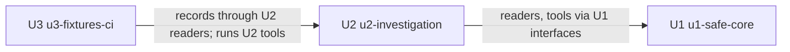

# Unit Dependencies: Ops Assistant MCP Server

## Dependency DAG

- **U2 `u2-investigation` depends on U1 `u1-safe-core`.** U2 adds readers and tools through the interfaces U1 fixes: the reader backend interface, the ToolCatalog registration API, the evidence record types, the EvidencePipeline input and the Redactor. It also extends U1's minimal KubernetesReader, ReaderBackends and `namespace_overview`.
- **U3 `u3-fixtures-ci` depends on U2 `u2-investigation`.** FixtureRecorder reads through all five U2 readers, and the CI job runs the U2 tools on recorded fixtures. U3 depends on U1 transitively, through StartupGuard (the recorder's guard) and Redactor (the recorder, the leak scan and the seeded tests).



Text fallback: U2 → U1; U3 → U2. The graph is a chain, so it has no cycle.

```yaml
units:
  - name: u1-safe-core
    kind: service
    depends_on: []
  - name: u2-investigation
    kind: service
    depends_on: [u1-safe-core]
  - name: u3-fixtures-ci
    kind: library
    depends_on: [u2-investigation]
```

## Integration Points

| From | To | Integration | Shape |
|---|---|---|---|
| U2 | U1 | Reader backend interface | One interface per reader with live and fixture implementations, chosen only in `ReaderBackends` |
| U2 | U1 | Prompt-registration hook | Prompt content in; U1 renders it through EvidencePipeline and validates the DNS-1123 namespace argument [Q8] |
| U2 | U1 | ToolCatalog registration | Tool name, description, arguments, handler returning structured evidence records |
| U2 | U1 | Evidence records → EvidencePipeline | Structured records only, never text (ADR-003) |
| U2 | U1 | ClusterSession | Live backends for Prometheus, Loki and Argo CD read only through the GET-only session and service proxy |
| U3 | U2 | Readers in live mode | FixtureRecorder calls the readers, then Redactor, then writes per-source fixture formats |
| U3 | U1 | StartupGuard, Redactor | Recorder is guarded; recorder, leak scan and seeded tests use the one Redactor engine |
| U3 | U1, U2 | Fixture formats | The hand-written fixture layout from U1 and U2 is the format U3's recorded fixtures must match; the `seeded/` layout and fake marker from U1 are the format U3's seeded set must match [Q7] |
| U2, U3 | U1 | CI workflow | Both extend U1's `.github/workflows/ops-assistant.yml`; `ci.yml` and `deploy.yml` stay untouched [Q9] |

No unit shares mutable data with another at runtime; all three are one process (U1, U2) plus repo tooling (U3).

## Parallel Development Opportunities

None. The DAG is a single chain, so each unit has exactly one valid place in any topological order. The operator has also set the rule that each unit is merged before the next starts [Q4].

## Walking Skeleton

U1 is the first unit in the DAG and the integrated slice. It runs on its own: `namespace_overview` executes end to end on hand-written fixtures through the adapter, ToolCatalog, the minimal KubernetesReader, the fixture backend, EvidencePipeline and the transport, with no later unit present [Q1] [Q2] [Q3]. These automated checks are fixture-only. At the end of U1 the operator applies the identity kit to minikube and runs the server's start-up self-check live (U1-A1); the agent applies nothing [Q9].

## Sources

- `aidlc/spaces/default/intents/261015-ops-assistant/inception/units-generation/unit-of-work.md`
- `aidlc/spaces/default/intents/261015-ops-assistant/inception/domain-design/components.md`
- `aidlc/spaces/default/intents/261015-ops-assistant/inception/units-generation/units-generation-questions.md` [Q1] to [Q4], [Q7] to [Q9]

## Assumptions & Open Questions

None.
